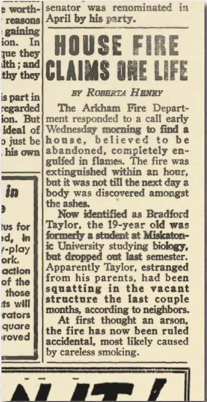
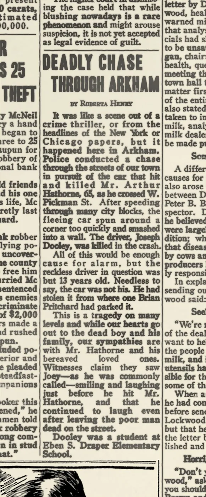

> **Раздатка «Шальная полночь» 3: «Пожар унёс жизнь»**
>
> ПОЖАР УНЁС ЖИЗНЬ  
> Роберта Генри  
> Рано утром в среду пожарная команда Аркхэма выехала по вызову и нашла дом, считавшийся заброшенным, целиком охваченным пламенем. Огонь потушили за час, но лишь на следующий день на пепелище нашли тело.  
> Теперь его опознали: это 19-летний Брэдфорд Тейлор, бывший студент-биолог Мискатоникского университета, бросивший учёбу в прошлом семестре. По словам соседей, Тейлор, поссорившийся с родителями, последние пару месяцев самовольно жил в пустующем доме.  
> Сначала пожар сочли поджогом, но теперь признали случайным: вероятнее всего, причина — неосторожное курение.

<!-- -->

> **Раздатка «Загубленная юность» 1: «Смертельная погоня по Аркхэму»**
>
> СМЕРТЕЛЬНАЯ ПОГОНЯ ПО АРКХЭМУ  
> Роберта Генри  
> Как в криминальном романе или заголовках нью-йоркских и чикагских газет — но случилось это здесь, в Аркхэме. Полиция гналась по улицам нашего города за машиной, которая сбила насмерть 65-летнего мистера Артура Хаторна, переходившего Уэст-Пикман-стрит. Промчавшись через много кварталов, беглая машина слишком быстро свернула за угол, её развернуло, и она врезалась в стену. Водитель, Джозеф Дули, погиб в аварии.  
> Одного этого хватило бы для тревоги, но безрассудному водителю было всего 13 лет. Нечего и говорить, что машина была не его: он угнал её оттуда, где её оставил некий Брайан Притчард.  
> Это трагедия во многих отношениях, и, хотя мы сочувствуем погибшему мальчику и его семье, наши соболезнования — мистеру Хаторну и его скорбящим близким. Свидетели утверждают, что видели, как Джоуи — так его обычно звали — улыбался и смеялся прямо перед тем, как сбить мистера Хаторна, и продолжал смеяться, оставив несчастного мёртвым на мостовой.  
> Дули учился в начальной школе имени Эбена С. Дрейпера.
