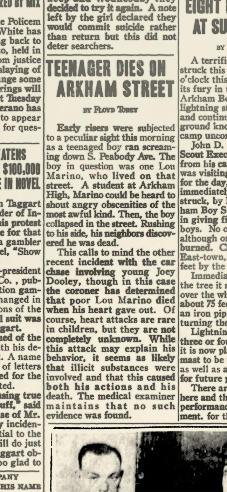
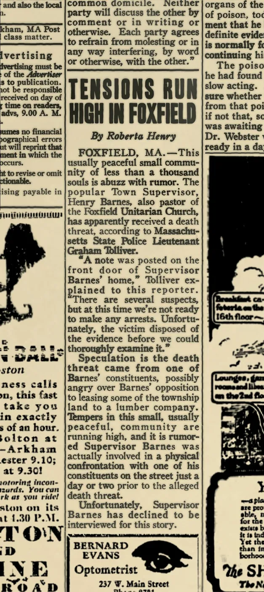

> **Раздатка «Загубленная юность» 2: «Подросток умер на улице Аркхэма»**
>
> ПОДРОСТОК УМЕР НА УЛИЦЕ АРКХЭМА  
> Флойд Тоби  
> Ранние прохожие стали сегодня утром свидетелями странного зрелища: по Саут-Пибоди-авеню с криками бежал подросток. Это был Лу Марино, живший на этой улице. Было слышно, как ученик Аркхэмской средней школы выкрикивает злобные непристойности самого ужасного свойства. Потом мальчик рухнул на мостовую. Бросившиеся к нему соседи обнаружили, что он мёртв.  
> Это напоминает недавний случай с погоней, в которой участвовал юный Джоуи Дули, хотя здесь коронер установил, что бедняга Лу Марино умер оттого, что не выдержало сердце. Разумеется, сердечные приступы у детей редки, но не так уж неслыханны. Хотя приступ мог бы объяснить его поведение, не менее вероятно, что тут замешаны запрещённые вещества, ставшие причиной и его поступков, и его смерти. Судмедэксперт утверждает, что никаких следов таковых не найдено.

<!-- -->

> **Раздатка «Доказательство жизни» 1: «Страсти накаляются в Фоксфилде»**
>
> СТРАСТИ НАКАЛЯЮТСЯ В ФОКСФИЛДЕ  
> Роберта Генри  
> ФОКСФИЛД, Массачусетс. — Этот обычно мирный городок, где живёт меньше тысячи душ, полнится слухами. Популярный глава тауншипа Генри Барнс, также пастор Фоксфилдской унитарианской церкви, по-видимому, получил угрозу смертью, сообщил лейтенант полиции штата Массачусетс Грэм Толливер.  
> «К входной двери дома главы тауншипа Барнса была приклеена записка, — пояснил Толливер вашему корреспонденту. — Подозреваемых несколько, но пока мы не готовы никого арестовать. К сожалению, потерпевший избавился от улики прежде, чем мы смогли её как следует осмотреть».  
> По предположениям, угроза исходила от одного из избирателей Барнса — возможно, недовольного тем, что Барнс противится сдаче части земли тауншипа в аренду лесозаготовительной компании. Страсти в этой маленькой, обычно мирной общине накаляются, и ходят слухи, что за день-два до предполагаемой угрозы глава тауншипа Барнс даже подрался с одним из своих избирателей прямо на улице.  
> К сожалению, глава тауншипа Барнс отказался дать интервью для этой статьи.
