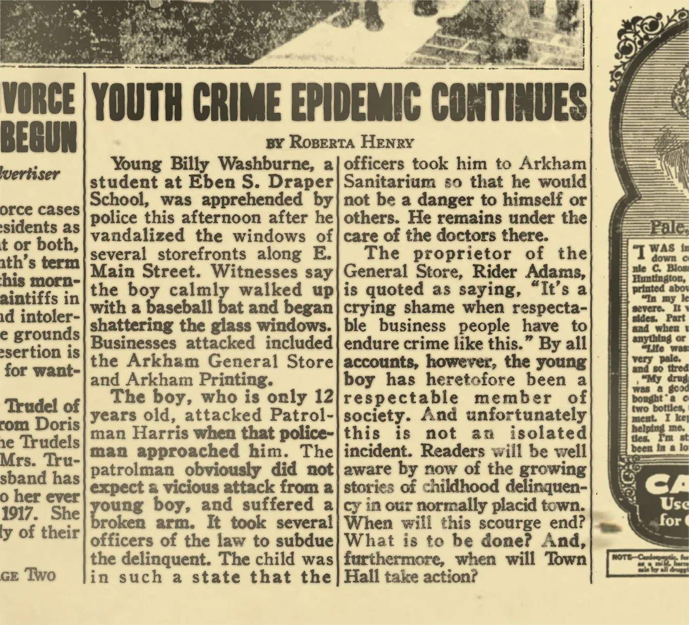

> **Раздатка «Загубленная юность» 3: «Эпидемия детской преступности продолжается»**
>
> ЭПИДЕМИЯ ДЕТСКОЙ ПРЕСТУПНОСТИ ПРОДОЛЖАЕТСЯ  
> Роберта Генри  
> Юный Билли Уошберн, ученик школы имени Эбена С. Дрейпера, задержан сегодня днём полицией, после того как разбил витрины нескольких лавок на Ист-Мейн-стрит. По словам свидетелей, мальчик спокойно подошёл с бейсбольной битой и принялся бить стёкла. Среди пострадавших заведений — Аркхэмский универсальный магазин и «Аркхэмская типография».  
> Мальчик, которому всего 12 лет, набросился на патрульного Харриса, когда тот подошёл к нему. Патрульный явно не ждал яростного нападения от мальчишки и получил перелом руки. Чтобы усмирить малолетнего правонарушителя, понадобилось несколько служителей закона. Ребёнок был в таком состоянии, что полицейские отвезли его в Аркхэмскую психбольницу, чтобы он не навредил себе или другим. Он остаётся под присмотром тамошних врачей.  
> Владелец универсального магазина Райдер Адамс сказал: «Просто позор, что уважаемым деловым людям приходится терпеть такие преступления». Впрочем, по общему мнению, мальчик до сих пор был уважаемым членом общества. И, к сожалению, это не единичный случай. Читатели уже хорошо знают о множащихся историях о детской преступности в нашем обычно спокойном городе. Когда кончится эта напасть? Что делать? И когда, наконец, возьмётся за дело городская управа?
