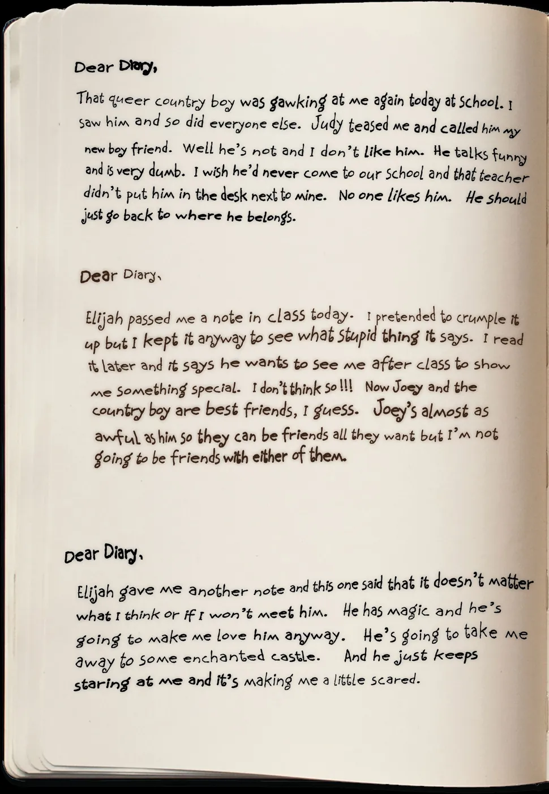

> **Раздатка «Загубленная юность» 4: дневник Сары Рид**
>
> Дорогой дневник,  
> Этот чудной деревенский мальчишка опять пялился на меня сегодня в школе. Я видела, и все видели. Джуди дразнила меня и назвала его моим новым ухажёром. Никакой он не ухажёр, и он мне не нравится. Он смешно говорит и ужасно тупой. Лучше бы он никогда не приходил в нашу школу и учительница не сажала его за парту рядом со мной. Его никто не любит. Пусть едет туда, где ему место.  
> Дорогой дневник,  
> Элайджа сегодня на уроке передал мне записку. Я сделала вид, что скомкала её, но всё-таки оставила, чтобы посмотреть, какую глупость он написал. Потом прочитала: он хочет встретиться после уроков и показать мне кое-что особенное. Ну уж нет!!! Теперь Джоуи с деревенщиной лучшие друзья, похоже. Джоуи почти такой же противный, как он, так что пусть дружат сколько хотят, а я не буду дружить ни с одним из них.  
> Дорогой дневник,  
> Элайджа передал мне ещё одну записку, и в ней написано, что неважно, что я думаю и не захочу ли я с ним встретиться. У него есть магия, и он всё равно заставит меня его полюбить. Он заберёт меня в какой-то заколдованный замок. И он всё время на меня смотрит, и мне от этого немножко страшно.
