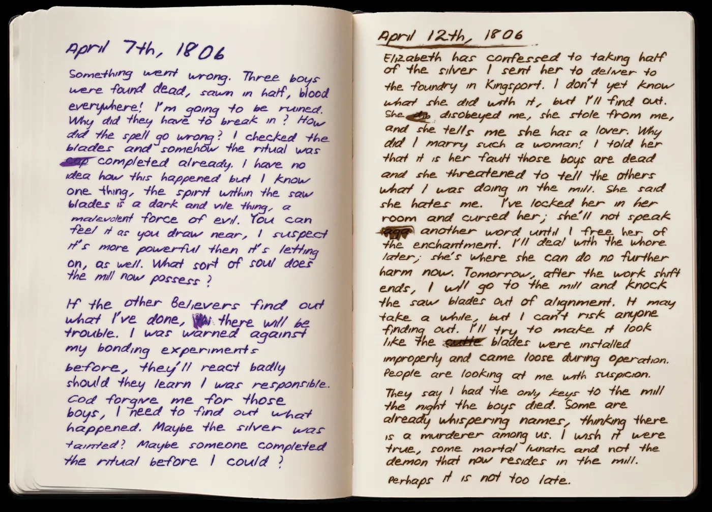

> **Раздатка «Дух предприятия» 1b: дневник Эверна Уэйтли (апрель 1806)**
>
> 7 апреля 1806 года  
> Что-то пошло не так. Трёх мальчишек нашли мёртвыми, распиленными пополам, всюду кровь! Я разорён. Зачем им понадобилось вламываться? Как заклинание могло пойти не так? Я осмотрел полотна — обряд каким-то образом уже завершён. Не представляю, как это случилось, но одно я знаю: дух в пильных полотнах — тёмная и мерзкая тварь, злобная сила зла. Это чувствуется, когда подходишь ближе, и подозреваю, что он сильнее, чем показывает. Какая же душа теперь у лесопилки?  
> Если остальные Верующие узнают, что я натворил, будет беда. Меня и раньше предостерегали от опытов со связыванием, и они отнесутся к этому скверно, если узнают, что виноват я. Господи, прости меня за этих мальчишек, я должен выяснить, что случилось. Может быть, серебро было нечистым? Может быть, кто-то завершил обряд раньше меня?  
> 12 апреля 1806 года  
> Элизабет призналась, что взяла половину серебра, которое я послал с ней на литейный завод в Кингспорт. Я ещё не знаю, что она с ним сделала, но выясню. Она ослушалась меня, обокрала меня и говорит, что у неё есть любовник. Зачем я женился на такой женщине! Я сказал ей, что это по её вине погибли мальчишки, а она пригрозила рассказать остальным, чем я занимаюсь на лесопилке. Сказала, что ненавидит меня. Я запер её в комнате и проклял: она не скажет ни слова, пока я не сниму с неё чары. С этой шлюхой я разберусь позже; там она больше не навредит. Завтра, после конца смены, я пойду на лесопилку и собью полотна с места. Это может занять время, но я не могу рисковать, чтобы кто-нибудь узнал. Постараюсь, чтобы выглядело так, будто полотна плохо установили и они расшатались за работой. Люди смотрят на меня с подозрением. Говорят, в ночь гибели мальчишек ключи от лесопилки были только у меня. Кое-кто уже шепчет имена, думая, что среди нас убийца. Хотел бы я, чтобы это было так — какой-нибудь смертный безумец, а не демон, что теперь живёт в лесопилке.  
> Может быть, ещё не поздно.
