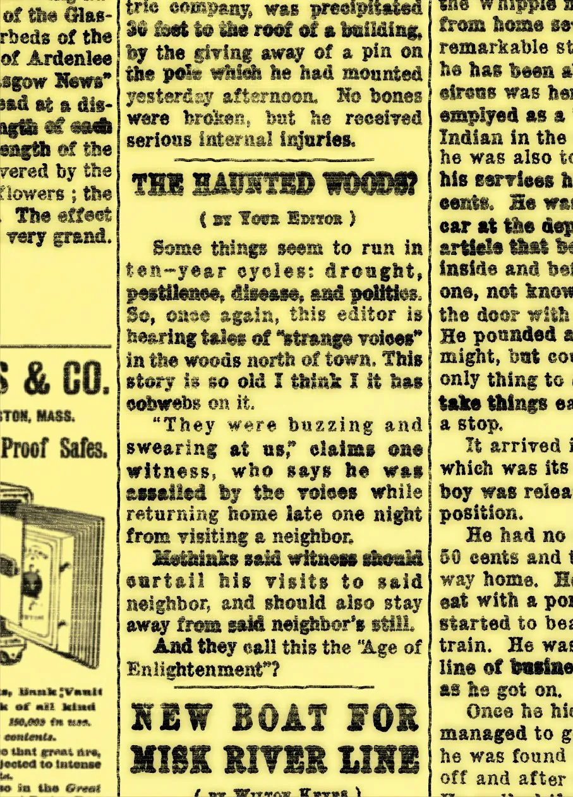
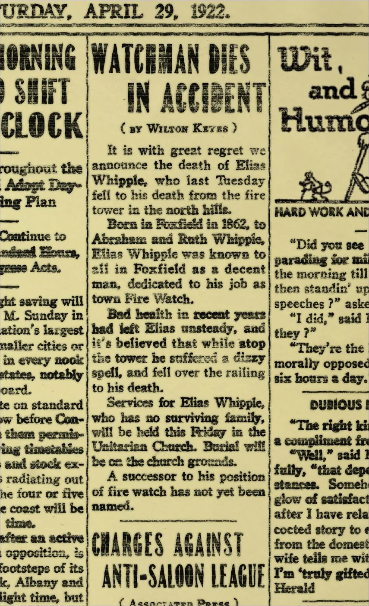

> **Раздатка «Доказательство жизни» 2: «Призрачный лес?»**
>
> ПРИЗРАЧНЫЙ ЛЕС?  
> (от вашего редактора)  
> Некоторые вещи, кажется, ходят десятилетними кругами: засуха, мор, болезни и политика. Вот и снова ваш редактор слышит байки о «странных голосах» в лесу к северу от города. История эта так стара, что, по-моему, уже поросла паутиной.  
> «Они жужжали и ругались на нас», — утверждает один свидетель, на которого, по его словам, голоса напали, когда он поздно ночью возвращался домой от соседа.  
> Сдаётся мне, означенному свидетелю следовало бы пореже ходить к означенному соседу, а также держаться подальше от самогонного аппарата означенного соседа.  
> И это они называют «веком просвещения»?

<!-- -->

> **Раздатка «Доказательство жизни» 3: «Смотритель погиб при несчастном случае»**
>
> …СУББОТА, 29 АПРЕЛЯ 1922 ГОДА.  
> СМОТРИТЕЛЬ ПОГИБ ПРИ НЕСЧАСТНОМ СЛУЧАЕ  
> (Уилтон Киз)  
> С глубоким прискорбием сообщаем о смерти Элайаса Уиппла, который в прошлый вторник разбился, упав с пожарной вышки в северных холмах.  
> Элайас Уиппл родился в Фоксфилде в 1862 году в семье Абрахама и Руфи Уиппл; весь Фоксфилд знал его как порядочного человека, преданного своей работе городского пожарного смотрителя.  
> Плохое здоровье в последние годы сделало Элайаса нетвёрдым на ногах, и считается, что наверху вышки у него закружилась голова и он упал через перила навстречу смерти.  
> Отпевание Элайаса Уиппла, не оставившего родных, состоится в эту пятницу в унитарианской церкви. Похоронят его на церковной земле.  
> Преемник на должность пожарного смотрителя пока не назначен.

*Прим. перев.:* На вырезке «Смотритель погиб при несчастном случае» стоит подпись Уилтон Киз. В тексте сценария (с. 79) владельца «Курьера» зовут Уилсон Киз.
