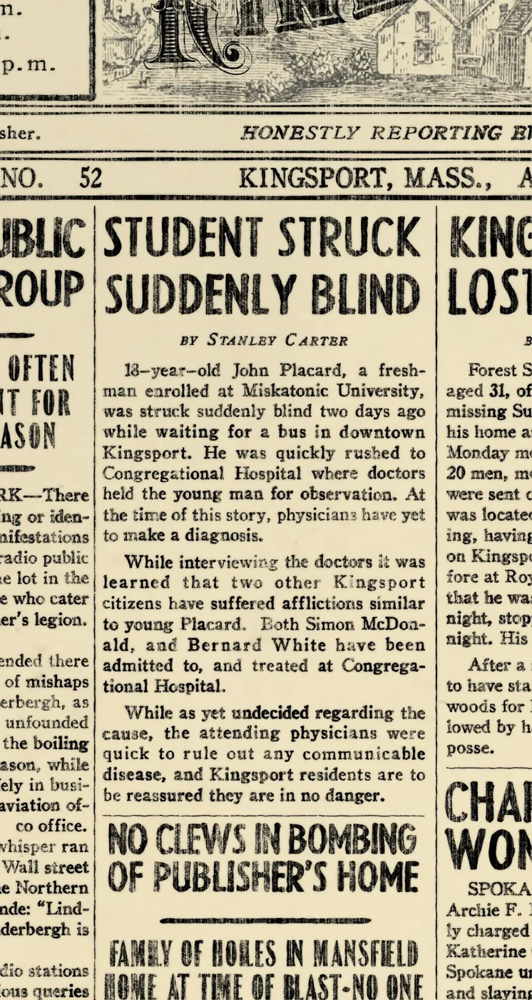
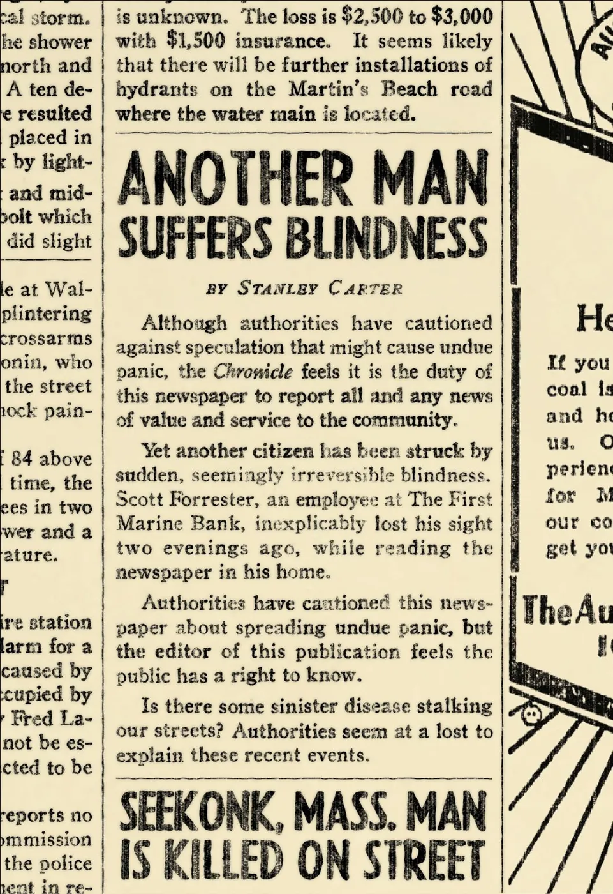

> **Раздатка «Вечная злоба» 1: «Студент внезапно ослеп»**
>
> …ЧЕСТНО СООБЩАЯ …  
> № 52 КИНГСПОРТ, МАСС., …  
> СТУДЕНТ ВНЕЗАПНО ОСЛЕП  
> СТЭНЛИ КАРТЕР  
> Восемнадцатилетний Джон Плакард, первокурсник Мискатоникского университета, два дня назад внезапно ослеп, ожидая автобуса в центре Кингспорта. Его срочно доставили в Конгрегационалистскую больницу, где врачи оставили юношу под наблюдением. На момент выхода заметки диагноз врачи так и не поставили.  
> Беседуя с врачами, мы узнали, что ещё двое жителей Кингспорта страдают тем же недугом, что и юный Плакард: и Саймона Макдональда, и Бернарда Уайта положили в Конгрегационалистскую больницу и лечат там.  
> Хотя причина пока не установлена, лечащие врачи сразу исключили заразную болезнь, и жители Кингспорта могут не беспокоиться — им ничто не грозит.

<!-- -->

> **Раздатка «Вечная злоба» 2: «Ещё один человек ослеп»**
>
> ЕЩЁ ОДИН ЧЕЛОВЕК ОСЛЕП  
> СТЭНЛИ КАРТЕР  
> Хотя власти предостерегают от домыслов, способных посеять ненужную панику, «Кроникл» считает своим долгом сообщать обо всём, что ценно и полезно обществу.  
> Ещё один горожанин внезапно и, по-видимому, необратимо ослеп. Скотт Форрестер, служащий Первого морского банка, позавчера вечером необъяснимым образом лишился зрения, читая газету у себя дома.  
> Власти предостерегали нашу газету от распространения ненужной паники, но редактор издания считает, что публика имеет право знать.  
> Неужели по нашим улицам крадётся какая-то зловещая болезнь? Власти, похоже, не могут объяснить последние события.

*Прим. перев.:* Во второй вырезке сказано, что Скотт Форрестер ослеп два вечера назад, читая дома газету. По тексту сценария (с. 103) это случилось днём ранее, 5 ноября, в обеденный перерыв.
