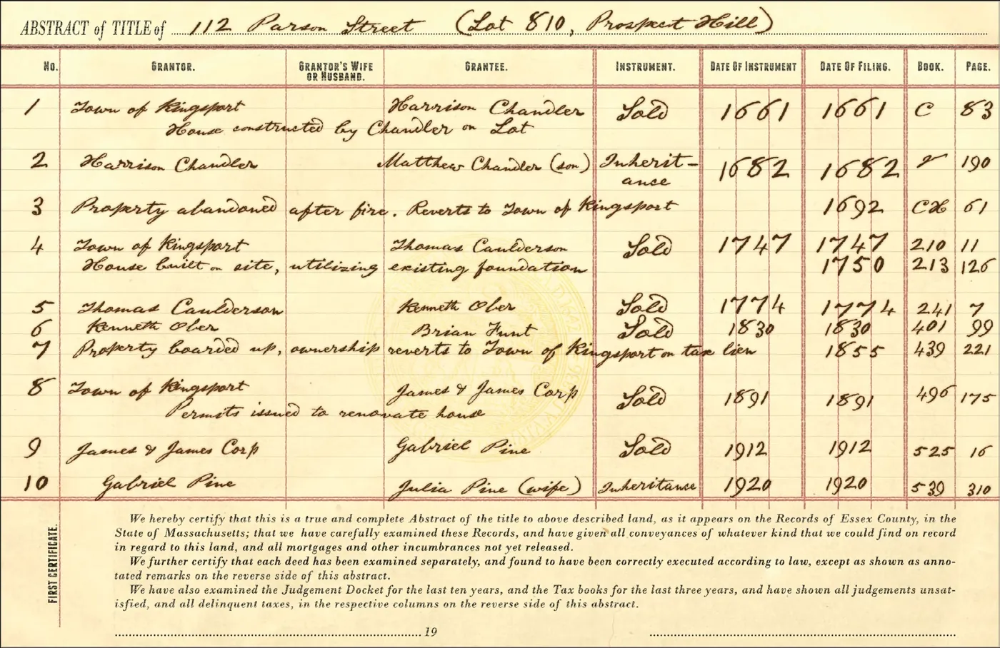

> **Раздатка «Вечная злоба» 4: выписка о праве собственности на Парсон-стрит, 112**
>
> ВЫПИСКА О ПРАВЕ СОБСТВЕННОСТИ на Парсон-стрит, 112 (участок 810, Проспект-Хилл)  
>
> | № | Отчуждатель | Супруг(а) отчуждателя | Приобретатель | Документ | Дата документа | Дата регистрации | Книга | Страница |
> |---|---|---|---|---|---|---|---|---|
> | 1 | Город Кингспорт — дом построен Чандлером на участке | | Харрисон Чандлер | Продажа | 1661 | 1661 | C | 83 |
> | 2 | Харрисон Чандлер | | Мэттью Чандлер (сын) | Наследство | 1682 | 1682 | v (?) | 190 |
> | 3 | Имущество брошено после пожара. Возвращено городу Кингспорту | | | | | 1692 | CX (?) | 61 |
> | 4 | Город Кингспорт — на участке построен дом на существующем фундаменте | | Томас Колдерсон | Продажа | 1747 | 1747; 1750 | 210; 213 | 11; 126 |
> | 5 | Томас Колдерсон | | Кеннет Обер | Продажа | 1774 | 1774 | 241 | 7 |
> | 6 | Кеннет Обер | | Брайан Фант | Продажа | 1830 | 1830 | 401 | 99 |
> | 7 | Дом заколочен, собственность возвращена городу Кингспорту за долги по налогам | | | | | 1855 | 439 | 221 |
> | 8 | Город Кингспорт — выданы разрешения на ремонт дома | | «Джеймс энд Джеймс корп.» | Продажа | 1891 | 1891 | 496 | 175 |
> | 9 | «Джеймс энд Джеймс корп.» | | Габриэль Пайн | Продажа | 1912 | 1912 | 525 | 16 |
> | 10 | Габриэль Пайн | | Джулия Пайн (жена) | Наследство | 1920 | 1920 | 539 | 310 |
>
> Настоящим удостоверяем, что это верная и полная выписка о праве собственности на описанный выше участок в том виде, в каком она значится в реестрах округа Эссекс штата Массачусетс; что мы тщательно изучили эти реестры и привели все сделки любого рода, какие смогли найти в отношении этого участка, а также все не погашенные ещё закладные и иные обременения.  
> Далее удостоверяем, что каждая купчая изучена отдельно и составлена по закону, кроме отмеченного в примечаниях на обороте выписки.  
> Мы изучили также реестр судебных решений за последние десять лет и налоговые книги за последние три года и указали все неисполненные решения и все налоговые недоимки в соответствующих графах на обороте выписки.  
> 19

*Прим. перев.:* В выписке покупка дома Габриэлем Пайном датирована 1912 годом, а получение наследства Джулией — 1920-м. По тексту сценария (с. 102) Пайны въехали в 1913 году, а отец Ронни умер, когда мальчику было десять лет, около 1925 года.
