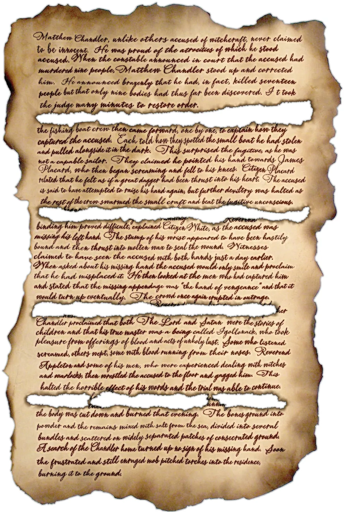

> **Раздатка «Вечная злоба» 5: протокол суда над Мэттью Чандлером**
>
> Мэттью Чандлер, в отличие от прочих обвинённых в колдовстве, ни разу не назвал себя невиновным. Он гордился зверствами, в которых его обвиняли. Когда констебль объявил в суде, что обвиняемый убил девять человек, Мэттью Чандлер встал и поправил его. Он нагло заявил, что на самом деле убил семнадцать человек, а нашли пока только девять тел. Судье понадобилось много минут, чтобы восстановить порядок.  
> […] затем рыбаки один за другим выходили вперёд и рассказывали, как поймали обвиняемого. Каждый рассказал, как они заметили в темноте украденную им лодочку и подошли к ней борт о борт. Беглеца это застало врасплох: моряк из него был никудышный. По их словам, он указал рукой на Джеймса Плакарда, и тот закричал и упал на колени. Гражданин Плакард рассказал, что ему почудилось, будто в сердце ему вонзили огромный кинжал. Говорят, обвиняемый попытался снова поднять руку, но дальнейшую чертовщину пресекли: остальные рыбаки ринулись в лодку и избили беглеца до беспамятства.  
> […] связать его было непросто, объяснил гражданин Уайт, потому что у обвиняемого не было левой кисти. Обрубок запястья, похоже, наспех перевязали и сунули в расплавленный воск, чтобы запечатать рану. Свидетели утверждали, что всего днём раньше видели обвиняемого с обеими руками. На вопрос о пропавшей руке обвиняемый лишь улыбался и заявлял, что куда-то её задевал. Затем он посмотрел на поймавших его людей и сказал, что пропавшая конечность — «рука мщения» и что рано или поздно она объявится. Толпа вновь взорвалась возмущением.  
> […] Чандлер объявил, что и Господь, и Сатана — детские сказки, а его истинный хозяин — существо по имени Иголлонак, которому любезны кровавые подношения и нечестивая похоть. Одни слушатели кричали, другие плакали, у некоторых шла носом кровь. Тогда преподобный Эпплтон и несколько его людей, знавших толк в обращении с ведьмами и колдунами, повалили обвиняемого на пол и заткнули ему рот. Это прекратило ужасное действие его слов, и суд смог продолжиться.  
> […] тем же вечером тело сняли и сожгли. Кости смололи в порошок, а останки смешали с морской солью, разделили на несколько свёртков и рассеяли по далеко отстоящим друг от друга клочкам освящённой земли. Обыск в доме Чандлера не нашёл и следа пропавшей руки. Вскоре раздосадованная и всё ещё разъярённая толпа забросала дом факелами и сожгла его дотла.
