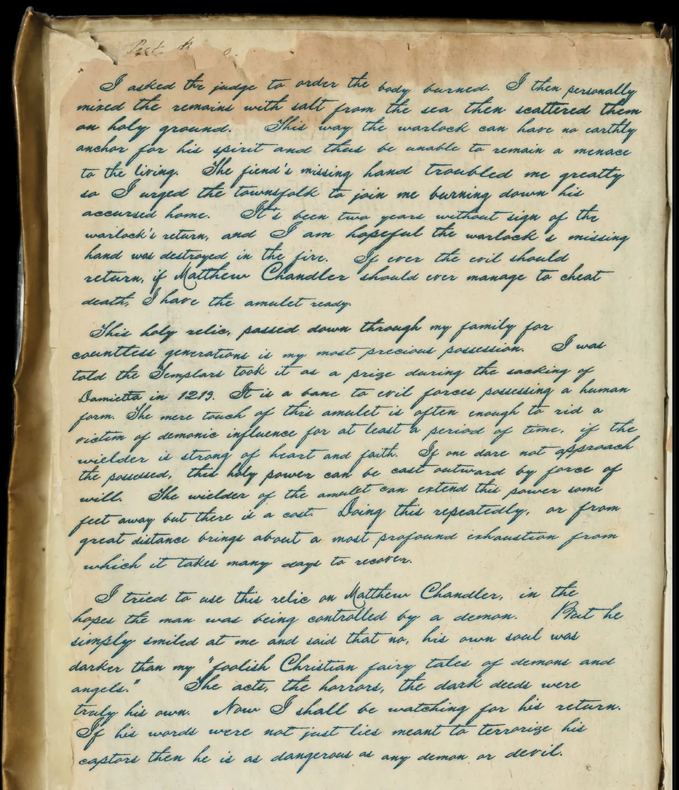

> **Раздатка «Вечная злоба» «5»: дневник в Библии Дэвида Эпплтона**
>
> Я просил судью распорядиться сжечь тело. Затем я сам смешал прах с морской солью и рассеял его на святой земле. Так у колдуна не останется земного якоря для духа, и он не сможет и дальше грозить живым. Пропавшая рука злодея сильно меня тревожила, и я уговорил горожан вместе со мной сжечь его проклятый дом. Вот уже два года нет и следа возвращения колдуна, и я надеюсь, что его пропавшая рука сгорела в огне. Если же зло когда-нибудь вернётся, если Мэттью Чандлеру когда-нибудь удастся обмануть смерть, амулет у меня наготове.  
> Эта святая реликвия, бессчётные поколения передававшаяся в моей семье, — самое драгоценное, что у меня есть. Мне говорили, что её взяли тамплиеры как трофей при разграблении Дамиетты в 1219 году. Она — погибель для злых сил, овладевших человеческим телом. Одного прикосновения этого амулета часто довольно, чтобы хотя бы на время избавить жертву от бесовской власти, если владеющий им твёрд сердцем и верой. Если кто не смеет подойти к одержимому, эту святую силу можно направить вовне силой воли. Владеющий амулетом может распространить её на несколько шагов вокруг, но за это приходится платить. Если делать так раз за разом или издалека, наступает глубочайшее изнеможение, от которого оправляешься много дней.  
> Я пытался применить реликвию к Мэттью Чандлеру в надежде, что этим человеком управляет демон. Но он лишь улыбнулся мне и сказал, что нет: его собственная душа темнее моих «глупых христианских сказок о демонах и ангелах». Эти дела, эти ужасы, эти тёмные деяния были воистину его собственными. Теперь я буду ждать его возвращения. Если его слова были не просто ложью, чтобы застращать поймавших его, то он опасен, как любой демон или дьявол.

*Прим. перев.:* В книге номер 5 присвоен двум раздаткам «Вечная злоба»: протоколу суда на с. 174 и дневнику Эпплтона на этой странице.
