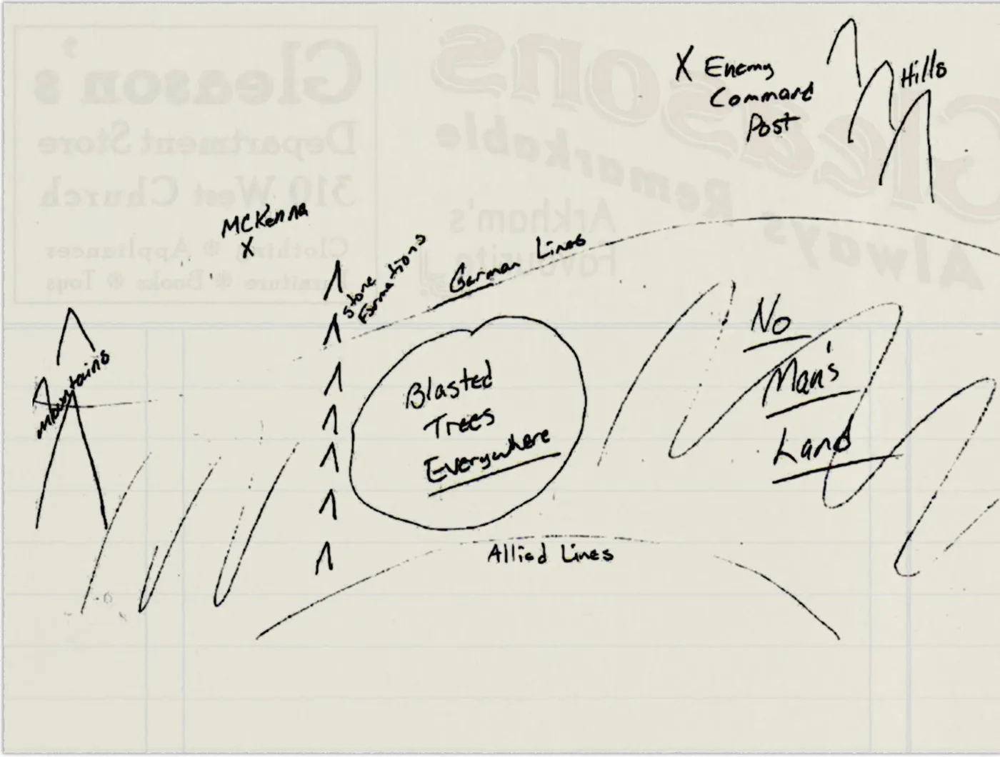

> **Раздатка «Ночная война» 1: карта Кирка**
>
> - Горы
> - Маккенна ✕
> - Каменные образования
> - Немецкие позиции
> - Выжженные деревья повсюду
> - Союзные позиции
> - Ничейная земля
> - ✕ Вражеский командный пункт
> - Холмы
