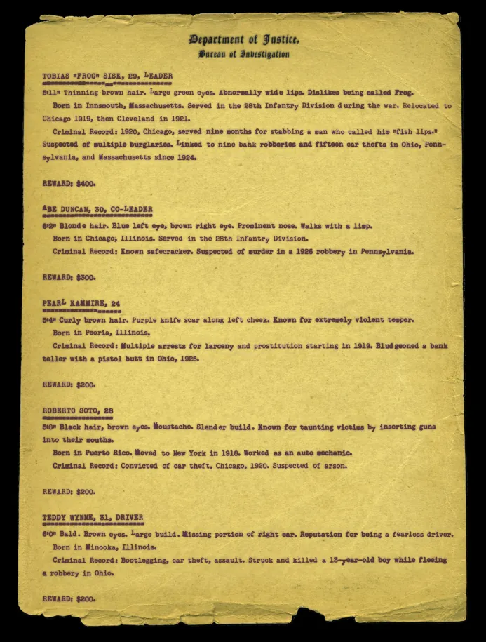

*«Любовь матери». Раздатка 1.*

> **Раздатка H01: документы «Материнская любовь» № 1 (досье Бюро на банду «Лягушка»)**
>
> Министерство юстиции, Бюро расследований  
>
> Тобиас «Лягушка» Сиск, 29, главарь  
> 5'11" Редеющие каштановые волосы. Большие зелёные глаза. Необычно широкие губы. Не любит, когда его называют Лягушкой.  
> Родился в Иннсмуте, штат Массачусетс. Во время войны служил в 28-й пехотной дивизии. Переехал в Чикаго в 1919 году, затем в Кливленд в 1921-м.  
> Судимости: 1920, Чикаго, отсидел девять месяцев за то, что зарезал человека, назвавшего его «рыбьими губами». Подозревается в многочисленных кражах со взломом. С 1924 года связан с девятью ограблениями банков и пятнадцатью угонами автомобилей в Огайо, Пенсильвании и Массачусетсе.  
> НАГРАДА: $400.  
>
> Эйб Дункан, 30, помощник главаря  
> 6'2" Светлые волосы. Левый глаз голубой, правый карий. Выдающийся нос. Хромает.  
> Родился в Чикаго, штат Иллинойс. Служил в 28-й пехотной дивизии.  
> Судимости: известный взломщик сейфов. Подозревается в убийстве во время ограбления в Пенсильвании в 1926 году.  
> НАГРАДА: $300.  
>
> Пёрл Каммайр, 24  
> 5'4" Вьющиеся каштановые волосы. Лиловый шрам от ножа вдоль левой щеки. Известна крайне вспыльчивым нравом.  
> Родилась в Пеории, штат Иллинойс.  
> Судимости: многочисленные аресты за кражи и проституцию, начиная с 1919 года. В Огайо в 1925 году ударила банковского кассира рукоятью пистолета.  
> НАГРАДА: $200.  
>
> Роберто Сото, 28  
> 5'8" Чёрные волосы, карие глаза. Усы. Худощавый. Известен тем, что дразнит жертв, засовывая им в рот оружие.  
> Родился в Пуэрто-Рико. В 1918 году переехал в Нью-Йорк. Работал автомехаником.  
> Судимости: осуждён за угон автомобиля, Чикаго, 1920 год. Подозревается в поджоге.  
> НАГРАДА: $200.  
>
> Тедди Уинн, 31, водитель  
> 6'0" Лысый. Карие глаза. Крупное телосложение. Отсутствует часть правого уха. Репутация бесстрашного водителя.  
> Родился в Минуке, штат Иллинойс.  
> Судимости: бутлегерство, угон автомобиля, нападение. В Огайо, спасаясь после ограбления, сбил и убил 13-летнего мальчика.  
> НАГРАДА: $200.

*Прим. перев.:* Рост в метрах по принятому приблизительному пересчёту: Сиск — 1,97 м, Дункан — 2,06 м, Каммайр — 1,78 м, Сото — 1,89 м, Уинн — 2 м.
