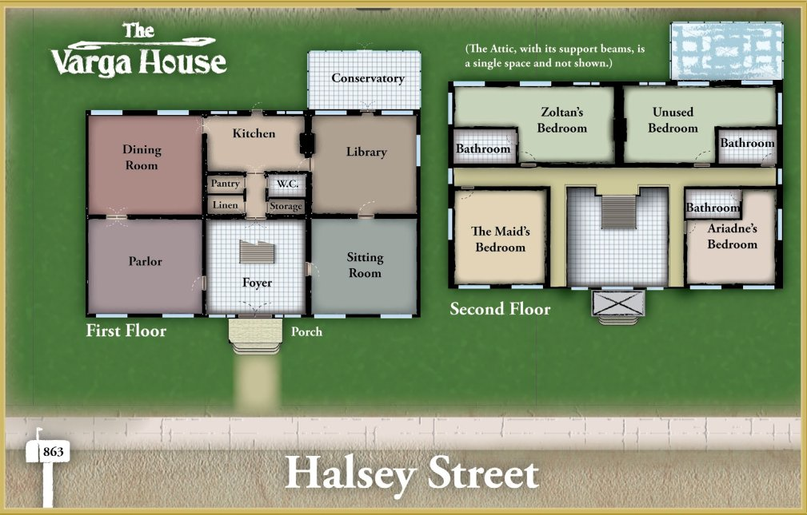

## План дома Варги

- Первый этаж: столовая, кухня, оранжерея, библиотека, кладовая, бельевая, уборная, чулан, малая гостиная, прихожая, гостиная, крыльцо.
- Второй этаж: спальня служанки, спальня Золтана, пустая спальня, спальня Ариадны, три ванные.
- Чердак с опорными балками представляет собой единое помещение и на плане не показан.
- Холси-стрит, 863 (номер на почтовом ящике).
