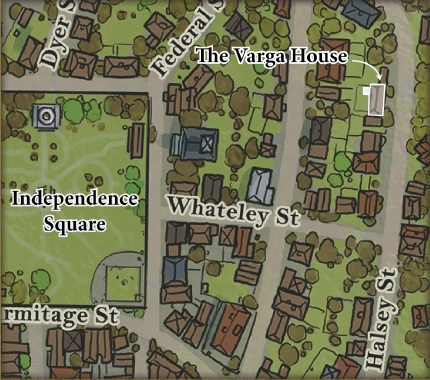
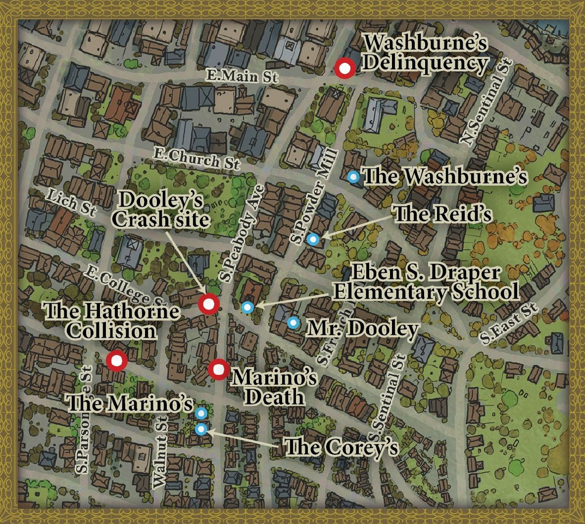

## Дом Варги на карте Аркхэма

- Дом Варги, площадь Независимости.
- Улицы: Дайер-стрит, Федерал-стрит, Уэйтли-стрит, Армитидж-стрит, Холси-стрит.

## Аркхэм: места «Загубленной юности»

- Разбитые витрины на Ист-Мейн-стрит, дом Уошбернов, дом Ридов, школа имени Эбена С. Дрейпера, дом Дули.
- Место аварии Джоуи Дули, место наезда на Артура Хаторна, место смерти Лу Марино, дом Марино, дом Кори.
- Улицы: Ист-Мейн-стрит, Ист-Чёрч-стрит, Лич-стрит, Ист-Колледж-стрит, Саут-Пибоди-авеню, Саут-Паудер-Милл-стрит, Норт-Сентинел-стрит, Саут-Сентинел-стрит, Саут-Френч-Хилл-стрит, Саут-Ист-стрит, Саут-Парсонейдж-стрит и Уолнат-стрит.

*Прим. перев.:* Улица Sentinel на нижней карте дважды подписана Sentinal. В переводе использовано «Сентинел-стрит».
