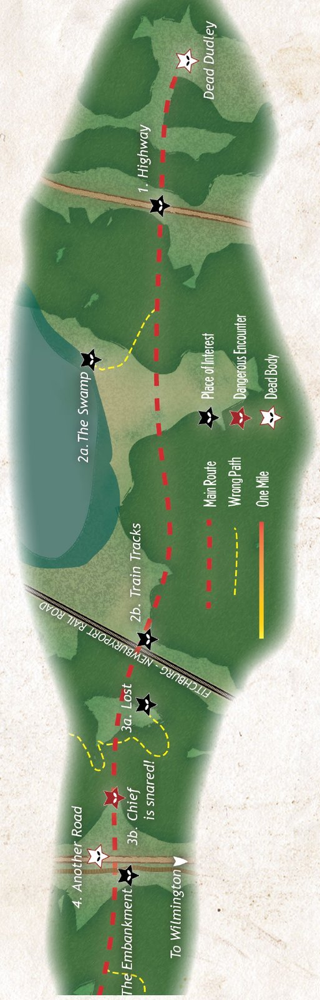

## Тропа ужаса (1): от лагеря до насыпи

- Мёртвый Дадли.
- 1. Шоссе.
- 2a. Болото.
- 2b. Железнодорожные пути. Железная дорога Фитчбург — Ньюберипорт.
- 3a. Сбились с пути.
- 3b. Чиф в петле!
- 4. Ещё одна дорога. Стрелка указывает на Уилмингтон.
- Насыпь.
- Красный пунктир — основной путь, жёлтый пунктир — ложный путь. Масштабная линейка соответствует 1,6 км.
- Чёрная звезда — примечательное место, красная — опасная встреча, белая — мёртвое тело.
