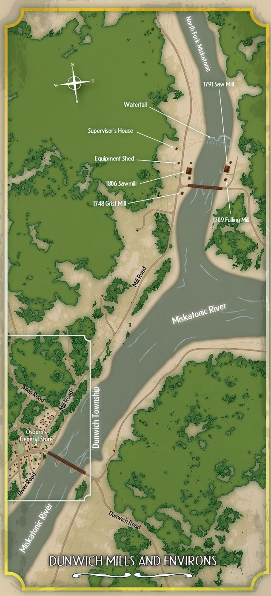

## Мельницы Данвича и окрестности

- Северный рукав Мискатоника, река Мискатоник, водопад у лесопилки.
- Дом управляющего, сарай для оборудования, лесопилка 1806 года, мукомольная мельница 1748 года, лесопилка 1791 года, сукновальня 1709 года.
- Тауншип Данвич, универсальный магазин Осборна.
- Аллен-роуд, Милл-роуд, Ривер-роуд, Данвич-роуд.
- Стороны света: С, Ю, З, В.
