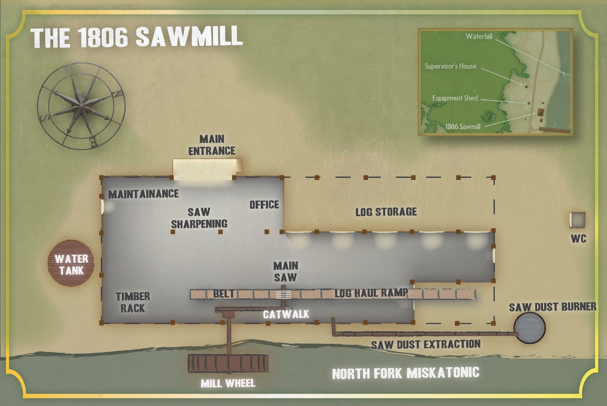

## План лесопилки 1806 года

- Главный вход, мастерская, заточка пил, контора, склад брёвен, уборная.
- Водонапорный бак, стеллаж для бруса, главная пила, приводной ремень, рампа подачи брёвен, мостки лесопилки, вытяжка опилок, опилочная печь.
- Водяное колесо, Северный рукав Мискатоника. Стороны света: С, Ю, З, В.
- На врезке: водопад, дом управляющего, сарай для оборудования, лесопилка 1806 года.

*Прим. перев.:* На плане слово Maintenance («мастерская») напечатано как Maintainance.
