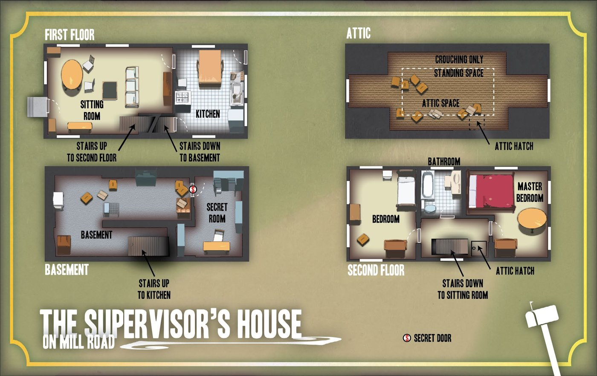

## План дома управляющего на Милл-роуд

- Первый этаж: гостиная, кухня, лестница на второй этаж, лестница в подвал.
- Второй этаж: спальня, ванная, главная спальня дома управляющего, лестница вниз в гостиную, люк на чердак.
- Чердак: чердачное помещение, участок в полный рост, участок, где можно пройти только пригнувшись, люк.
- Подвал: основное помещение, лестница наверх на кухню, тайная комната (алхимическая лаборатория Эверна Уэйтли).
- S — потайная дверь.
