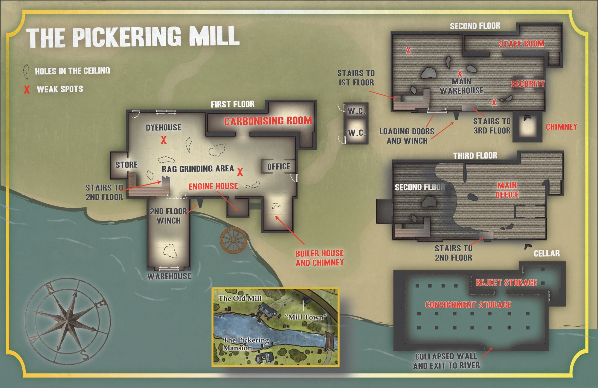

## План фабрики Пикерингов

- Пунктирные контуры — дыры в потолке. Красный X — слабое место пола.
- Первый этаж: красильня, карбонизационный цех, кладовая, зона измельчения ветоши, контора, лестница на второй этаж, машинное отделение, лебёдка на второй этаж, склад, котельная и труба, две уборные.
- Второй этаж: лестница на первый этаж, главный склад, комната персонала, охрана, погрузочные двери и лебёдка, лестница на третий этаж, труба.
- Третий этаж: главная контора, второй этаж виден в провале, лестница на второй этаж.
- Подвал: склад брака, склад партий, обрушенная стена и выход к реке.
- На врезке: старая фабрика, «Милл-таун», особняк Пикерингов.
- Стороны света: С, Ю, З, В.
