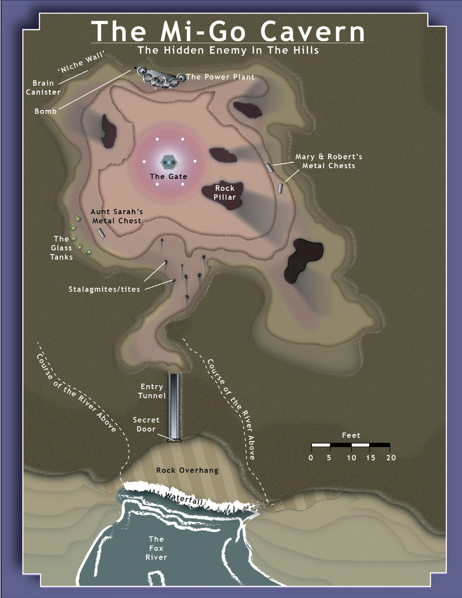

## План пещеры ми-го

*Тайный враг в холмах*

- Стена с нишами, мозговой цилиндр «Смотритель», бомба ми-го, машина ми-го (энергоустановка), Врата ми-го в Фоксфилде, скальный столб.
- Металлические сундуки Мэри и Роберта, металлический сундук тёти Сары, стеклянные баки ми-го, сталагмиты и сталактиты.
- Входной тоннель, потайная дверь, скальный навес, водопад Фокс-Ривер, река Фокс, русло реки над пещерой.
- Шкала масштаба: 0 — 1,7 — 3,3 — 5 — 6,7 м.
