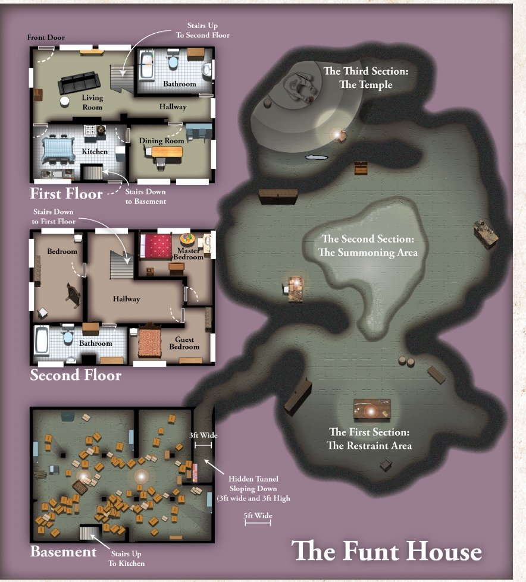

## План Дома Фантов

- Первый этаж: входная дверь, гостиная Дома Фантов, ванная Дома Фантов, прихожая, кухня Дома Фантов, столовая Дома Фантов, лестница на второй этаж и лестница в подвал.
- Второй этаж: лестница на первый этаж, спальня, хозяйская спальня Дома Фантов, коридор, ванная, гостевая спальня Дома Фантов.
- Подвал: лестница на кухню, наклонный потайной ход шириной и высотой около 1 м.
- Первая часть — место для пленников. Вторая часть — место призыва. Третья часть — храм.
- Отметки ширины: 1 м у хода, 1,7 м у масштабной линейки.
