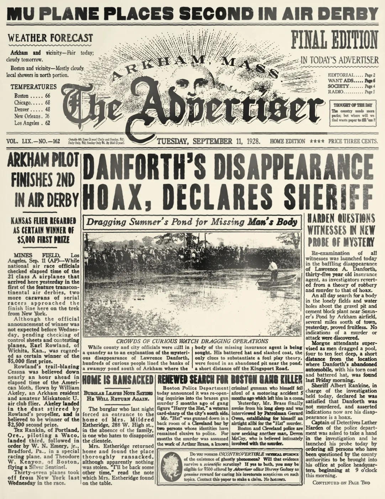

## «Аркхэм Адвертайзер». Полоса 1

> **Раздатка. «Аркхэм Адвертайзер», 11 сентября 1928 года**

**Аркхэм, Массачусетс. Последний выпуск.** Том LIX, № 162. Вторник, 11 сентября 1928 года. Местный выпуск. Цена 3 цента.

**Подписка по почте за пределами четвёртой зоны, на год:** ежедневный и воскресный выпуски — $17, только ежедневный — $12, только воскресный — $6.

**Прогноз погоды.** В Аркхэме и окрестностях сегодня ясно, завтра облачно. В Бостоне и окрестностях преимущественно облачно, местами на севере кратковременные дожди.

**Температура:** Бостон +19 °C, Чикаго +20 °C, Денвер +9 °C, Новый Орлеан +24 °C, Лос-Анджелес +17 °C.

**В сегодняшнем номере:** редакционная статья — с. 2, объявления — с. 6, светская жизнь — с. 4, радио — с. 5.

**Мысль дня.** Стране нужно больше парков. Только где взять столько бумажек, чтобы их засыпать?

### Самолёт Мискатоникского университета — второй в воздушной гонке

**Лётчик из Аркхэма финиширует вторым. Победа и приз в $5 000, по всей видимости, достанутся лётчику из Канзаса.**

МАЙНС-ФИЛД, Лос-Анджелес, 11 сентября (АП). Пока судьи национальных соревнований подсчитывали полётное время 21 самолёта класса А, прибывшего сюда вчера в ходе первой из главных трансконтинентальных гонок, к финишу приближались ещё две группы участников перелёта из Нью-Йорка.

Официального объявления победителя ждут к среде, когда будут проверены контрольные ведомости и самолёты участников. Однако первым призёром с наградой в $5 000 уже считают Эрла Роуленда из Уичито, штат Канзас.

Считается, что шедшая впереди «Сессна» Роуленда выиграла по полётному времени почти час у «Американ Мот» Уильяма Экли, жителя Аркхэма и лётчика-любителя из аэроклуба Мискатоникского университета. Экли сел в пыль, взметённую винтом машины Роуленда. Ему, вероятно, достанется второй приз в $2 500.

Третьим приземлился Текс Рэнкин из Портленда, штат Орегон, на самолёте «Уэйко». За ним финишировали У. Н. Эмери-младший из Брэдфорда, штат Пенсильвания, на специально построенном гоночном самолёте и Теодор У. Кеньон из Бостона на «Сильвер сентинел».

В прошлую среду из Нью-Йорка на гонку вылетели 37 самолётов.

*Прим. перев.:* В заметке о перелёте набрано serial racers. По смыслу речь об участниках воздушной гонки.

### Исчезновение Данфорта — инсценировка, заявляет шериф

**В пруду Самнера ищут тело пропавшего.**

*Подпись к фотографии. Толпы зевак наблюдают за поисками с баграми.*

Пока власти округа и города ломали голову над загадочным исчезновением Лоуренса Данфорта, сотни любопытных выстроились по берегам болотистого пруда к югу от Аркхэма, где ищут тело пропавшего страхового агента. Его измятая шляпа и изрезанное пальто, единственные улики в пользу версии о преступлении, нашлись в заброшенном карьере у пруда, неподалёку от Кингспорт-роуд.

*Прим. перев.:* В подписи к фотографии напечатано quandry вместо quandary.

**Харден вновь допрашивает свидетелей**

Сегодня, в связи с загадочным исчезновением тридцатипятилетнего страхового агента Лоуренса А. Данфорта, следователи вновь принялись опрашивать всех свидетелей. Версия об ограблении и убийстве уступила место версии об инсценировке.

Вчера весь день искали тело в безлюдных полях и водоёмах возле гравийного карьера и завода бетонных блоков у пруда Самнера, близ аркхэмского аэродрома, в нескольких километрах к югу от города. Поиски были безрезультатны. Следов убийства или нападения не обнаружено.

Под надзором служителей морга рабочие обшарили баграми водоём глубиной от 1,3 до 3,3 м. Рядом утром прошлой пятницы обнаружили брошенный автомобиль Данфорта с его изорванным пальто и измятой шляпой.

Шериф Альберт Ранкин, руководивший сегодняшним расследованием, заявил, что убеждён в отсутствии убийства. По его словам, всё теперь указывает на то, что Данфорт сам подстроил своё исчезновение.

К расследованию привлекли начальника сыскного отдела полиции капитана Лютера Хардена. Он распорядился с девяти утра доставлять к нему в полицейское управление всех, кого уже опросили власти округа.

*Продолжение на с. 2.*

### В доме всё перевёрнуто. Взломщик обещал вернуться

Взломщик, вчера вечером проникший в дом миссис Милдред Эстеридж по адресу Уэст-Хай-стрит, 288, когда семьи не было дома, похоже, дорожит своей клиентурой.

Миссис Эстеридж вернулась и обнаружила, что всё в доме перевёрнуто вверх дном, хотя вроде бы ничего не пропало. На столе лежала записка: «Как-нибудь ещё загляну».

### Возобновились поиски убийцы бостонского гангстера

Бостонская полиция сообщила сегодня, что возобновляет расследование дерзкого убийства, совершённого пять месяцев назад. Жертва — «Гарри Шляпа», старый карточный шулер из южной части города, связанный с преступной средой.

Мистера «Шляпу» застрелили в подсобке кливлендского бара двое, чьи имена полиция до сих пор так и не установила. Месяцами убийство приписывали Артуру Брассу, известному бандиту. Пять месяцев назад он сам угодил в автомобильную аварию и впал в кому.

Вчера мистер Брасс наконец очнулся и дал показания патрульному Джерарду Оуэну. На время убийства «Шляпы» у него оказалось неопровержимое алиби.

Полиция Бостона и Кливленда теперь разыскивает другого человека, Девона Маккоя. Предполагается, что он непосредственно причастен к убийству.

*Прим. перев.:* Газета датирует гибель Гарри Шляпы пятью месяцами ранее. По сценарию «Шальная полночь» он погиб задолго до событий.

> У вас есть **НЕОПРОВЕРЖИМОЕ ВЕЩЕСТВЕННОЕ ДОКАЗАТЕЛЬСТВО** существования призраков? Выдержит ли оно научную проверку? Если на оба вопроса вы ответили утвердительно, то можете получить $500, которые редактор «Адвертайзера» Харви Гедни всерьёз обещает тому, кто излечит его от закоренелого скептицизма. Чтобы заявить о своих правах на награду, обратитесь в редакцию. Мистификаторов просим не беспокоиться.
