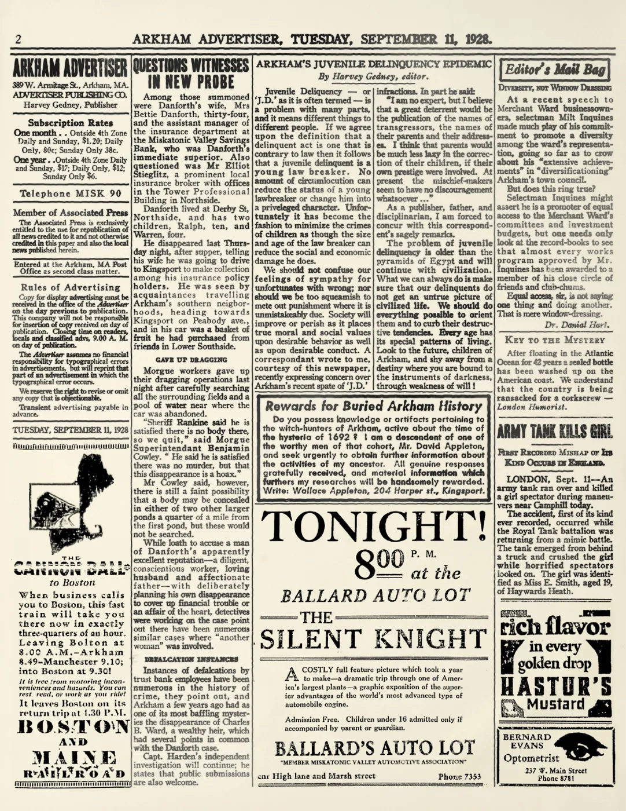

## «Аркхэм Адвертайзер». Полоса 2

**«Аркхэм Адвертайзер», вторник, 11 сентября 1928 года**

> **Издательские сведения.** Компания «Адвертайзер паблишинг». Издатель Харви Гедни. Уэст-Армитидж-стрит, 389, Аркхэм, Массачусетс. Телефон MISK 90.
>
> **Подписка за пределами четвёртой зоны.** На месяц: ежедневный и воскресный выпуски — $1,20, только ежедневный — 80 центов, только воскресный — 38 центов. На год: соответственно $17, $12 и $6.
>
> Член «Ассошиэйтед Пресс». Агентству принадлежит исключительное право перепечатывать все материалы, опубликованные со ссылкой на него и без иных указаний об источнике, а также местные новости газеты. В почтовом отделении Аркхэма газета зарегистрирована как отправление второго класса.
>
> **Порядок приёма объявлений.** Материалы для крупных рекламных объявлений должны поступить в редакцию накануне выхода номера. Компания не гарантирует размещение материалов, полученных в день выпуска. Объявления читателей, местные и рубричные объявления принимаются до девяти утра в день выпуска.
>
> Редакция не несёт материальной ответственности за опечатки в объявлениях, но перепечатает ту часть объявления, в которую вкралась опечатка. Редакция оставляет за собой право править или отклонять неподходящие материалы. Разовые объявления оплачиваются заранее.

> **«Пушечное ядро» до Бостона.** Когда дела зовут вас в Бостон, этот скорый поезд доставит вас туда ровно за три четверти часа. Отправление из Болтона в 8:00, Аркхэм в 8:49, Манчестер в 9:10, прибытие в Бостон в 9:30! Забудьте о неудобствах и опасностях автомобильной поездки. В пути можно отдохнуть, почитать или поработать. Обратный поезд отправляется из Бостона в 13:30. «Бостон энд Мэн рэйлроуд».

### Вновь допрошены свидетели

Среди вызванных были жена Данфорта, тридцатичетырёхлетняя миссис Бетти Данфорт, и заместитель заведующего страховым отделом Сберегательного банка долины Мискатоника, непосредственный начальник Данфорта. Допросили также мистера Эллиота Штиглайца, видного местного страхового брокера, чей офис находится в деловом здании Тауэра в Нортсайде.

*Прим. перев.:* Фамилия страхового брокера напечатана Stieglitz. В базе он значится как Эллиот Штиглайц (Elliot Stigleitz).

Данфорт жил на Дерби-стрит в Нортсайде. У него двое детей: Ральф, десяти лет, и Уоррен, четырёх лет.

Он исчез в прошлый четверг после ужина. Жене он сказал, что поедет в Кингспорт собрать взносы со своих страхователей. Знакомые видели, как он ехал через южные кварталы Аркхэма в сторону Кингспорта по Пибоди-авеню. В машине у него была корзина фруктов, купленная у друзей в Нижнем Саутсайде.

**Поиски в пруду прекращены**

Служители морга прекратили поиски вчера вечером, тщательно обследовав окрестные поля и водоём близ места, где бросили автомобиль.

«Шериф Ранкин сказал, что уверен: тела там нет. Вот мы и закончили, — рассказал заведующий моргом Бенджамин Коули. — Он уверен, что убийства не было и что исчезновение подстроено».

Впрочем, мистер Коули допустил, что тело могло оказаться в одном из двух других, более крупных прудов примерно в четырёхстах метрах от первого. Их обследовать не будут.

Сыщики, работающие над делом, не спешат обвинять человека с безупречной на вид репутацией, старательного и добросовестного работника, любящего мужа и заботливого отца, в том, что он заранее спланировал исчезновение, чтобы скрыть денежные неприятности или любовную связь. Однако, замечают они, в подобных делах уже не раз появлялась «другая женщина».

**Случаи растраты**

Сотрудники банков, пользующиеся доверием, не раз оказывались растратчиками, напоминают сыщики. Несколько лет назад одной из самых запутанных загадок Аркхэма стало исчезновение богатого наследника Чарльза Б. Уорда. Это дело во многом напоминает дело Данфорта.

Капитан Харден продолжит самостоятельное расследование. Он сообщил, что готов выслушать и горожан.

### Эпидемия детской преступности в Аркхэме

*Харви Гедни, редактор*

У детской преступности много сторон, и каждый понимает её по-своему. Если согласиться, что преступный поступок нарушает закон, то юный правонарушитель — это просто человек, нарушивший закон в юном возрасте. Словесные ухищрения не изменят его положения и не дадут ему особых прав. К сожалению, нынче принято преуменьшать преступления детей, будто малый рост и возраст нарушителя уменьшают вред, который он причиняет обществу и хозяйству.

Сочувствие к несчастным не должно мешать нам видеть проступок и налагать наказание там, где оно очевидно заслужено. Будет ли общество крепнуть или придёт в упадок, зависит от того, умеет ли оно по достоинству оценить нравственную и общественную пользу хороших поступков и достойного поведения. Недавно один читатель написал мне в редакцию, обеспокоенный участившимися в Аркхэме проступками малолетних. Приведу часть его письма.

> «Я не специалист, но полагаю, что хороший способ удержать детей от проступков — печатать имена нарушителей, имена их родителей и адреса. Родители куда усерднее взялись бы за воспитание детей, если бы на кону стояла их собственная репутация. Сейчас же, похоже, озорников вообще ничто не сдерживает…»

Как издатель, отец и сторонник строгого воспитания, не могу не согласиться с этими мудрыми словами.

Детская преступность старше египетских пирамид. Она будет существовать, пока существует цивилизация. В наших силах дать юным нарушителям верное представление о жизни в обществе. Нужно сделать всё возможное, чтобы направить их и обуздать разрушительные наклонности. У каждой эпохи свой уклад. Смотрите вперёд, дети Аркхэма, и берегитесь участи тех, кого слабость воли делает орудием тьмы!

*Прим. перев.:* В редакционной статье допущены опечатки Deliquency, priveleged, unmistakeably и correspondant.

> **Награда за сведения о забытом прошлом Аркхэма.** Располагаете ли вы сведениями или предметами, связанными с аркхэмскими охотниками на ведьм времён истерии 1692 года? Я потомок одного из достойных людей, состоявших в их рядах, мистера Дэвида Эпплтона, и настоятельно ищу сведения о делах моего предка. Буду признателен за каждый добросовестный отклик. За сведения, которые помогут моим изысканиям, щедро заплачу. Пишите Уоллесу Эпплтону по адресу Харпер-стрит, 204, Кингспорт.

> **Сегодня в 20:00 на автосалоне Балларда — «Тихий рыцарь».** На эту дорогостоящую полнометражную картину ушёл целый год. Вас ждёт увлекательная экскурсия по одному из самых больших заводов Америки и наглядный рассказ о преимуществах самого совершенного в мире автомобильного двигателя. Вход свободный. Дети младше 16 лет допускаются в сопровождении родителей или опекунов. Автосалон Балларда, член Автомобильной ассоциации долины Мискатоника. Угол Хай-лейн и Марш-стрит. Телефон 7353.

### Почта редактора

**Равное представительство или показуха?**

Недавно, выступая перед предпринимателями Торгового района, член городского совета Милт Инквайнс пространно говорил о своём стремлении расширить представительство округа. Он даже похвастался «обширными достижениями» в деле «разнообразизации» городского совета Аркхэма.

А похоже ли это на правду?

Господин Инквайнс может сколько угодно говорить о равном доступе к комитетам и инвестиционным средствам Торгового района. Достаточно взглянуть на документы, чтобы увидеть, что почти каждый проект, одобренный им, доставался кому-нибудь из его близких друзей или приятелей по клубу.

Равный доступ, сударь, требует, чтобы слова сходились с делом. Пока мы видим одну показуху.

*Доктор Дэниал Харт*

### Ключ к разгадке

У берегов Америки прибило запечатанную бутылку, проплававшую в Атлантическом океане 42 года. По нашим сведениям, вся страна сбилась с ног в поисках штопора.

*«Лондон юморист»*

### Армейский танк задавил девушку

**Первый зарегистрированный случай такого рода произошёл в Англии.**

ЛОНДОН, 11 сентября. Сегодня на учениях близ Кэмпхилла армейский танк переехал девушку, наблюдавшую за манёврами. Она погибла.

Первый известный несчастный случай такого рода произошёл, когда Королевский танковый батальон возвращался с учебного боя. Танк выехал из-за грузовика и раздавил девушку на глазах у потрясённых зрителей. Погибшая — девятнадцатилетняя мисс Э. Смит из Хейуордс-Хита.

> **Горчица «Хастур».** Насыщенный вкус в каждой золотистой капле.

> **Бернард Эванс, оптометрист.** Уэст-Мейн-стрит, 237. Телефон 8781.
