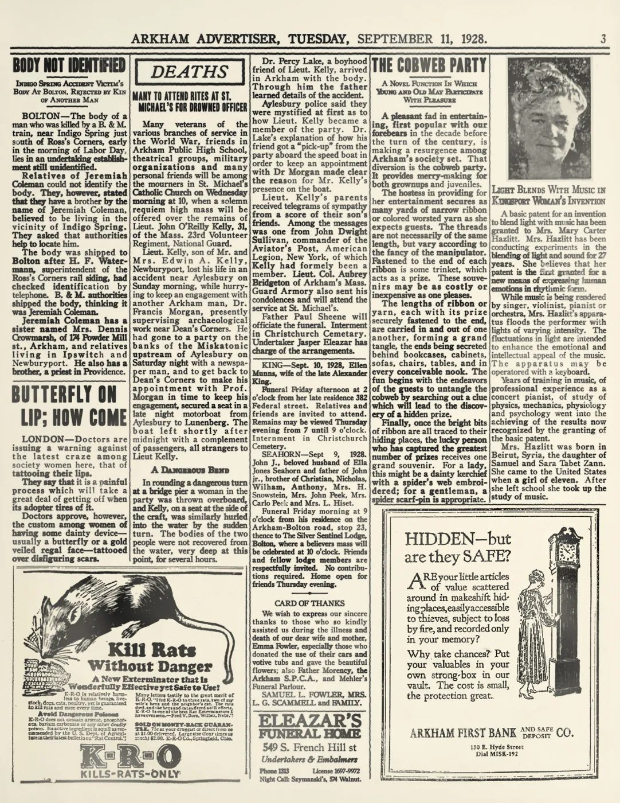

## «Аркхэм Адвертайзер». Полоса 3

**«Аркхэм Адвертайзер», вторник, 11 сентября 1928 года**

### Тело не опознано

**Родные другого человека не признали в погибшем у Индиго-Спринг своего родственника. Тело находится в Болтоне.**

БОЛТОН. Тело мужчины, погибшего под поездом «Бостон энд Мэн» ранним утром в День труда, всё ещё лежит неопознанным в похоронной конторе. Несчастье произошло близ Индиго-Спринг, к югу от Россес-Корнерс.

Родственники Джеремайи Коулмена не смогли опознать погибшего. Они сообщили, что у них есть брат по имени Джеремайя Коулмен и что он, вероятно, живёт в окрестностях Индиго-Спринг. Они попросили власти помочь его разыскать.

Тело отправили в Болтон после того, как начальник запасного пути в Россес-Корнерс Г. Ф. Ватерманн проверил сведения о личности погибшего по телефону. В железнодорожной компании полагали, что это Джеремайя Коулмен.

У Джеремайи Коулмена есть сестра, миссис Деннис Кроумарш, проживающая по адресу Паудер-Милл-стрит, 174, Аркхэм, и родня в Ипсуиче и Ньюберипорте. Его брат служит священником в Провиденсе.

### Бабочка на губе. Зачем?

ЛОНДОН. Врачи предостерегают от последнего увлечения здешних светских дам — татуировок на губах.

По их словам, делать татуировку больно, а когда она надоест, свести её будет непросто.

Зато врачи одобряют обычай прикрывать уродующие шрамы изящной татуировкой, обычно в виде бабочки или царственного лица под золотой вуалью.

### Некрологи

**На заупокойную службу по утонувшему офицеру в церкви Святого Михаила соберётся много людей**

В среду в 10 утра в католической церкви Святого Михаила отслужат торжественную заупокойную мессу по тридцатиоднолетнему лейтенанту Джону О’Рейли Келли из 23-го Массачусетского добровольческого полка Национальной гвардии. Среди собравшихся будут ветераны разных родов войск, воевавшие в Мировую войну, друзья из Аркхэмской государственной средней школы, представители театральных и военных организаций и многие близкие друзья покойного.

Лейтенант Келли, сын мистера и миссис Эдвин А. Келли из Ньюберипорта, погиб в воскресенье утром при несчастном случае близ Эйлсбери. Он спешил на встречу с другим аркхэмцем, доктором Фрэнсисом Морганом, который сейчас руководит археологическими работами у Динс-Корнерс. В субботу вечером Келли вместе с корреспондентом был на вечеринке на берегу Мискатоника выше Эйлсбери. Чтобы вернуться в Динс-Корнерс к назначенной встрече с профессором Морганом, он нашёл себе место на ночном моторном катере из Эйлсбери в Луненберг. Катер отошёл вскоре после полуночи. Ни с кем из пассажиров Келли знаком не был.

**Опасный поворот**

Когда катер резко повернул у опоры моста, одну из пассажирок выбросило за борт. Келли, сидевший у борта, тоже оказался в воде. В этом месте очень глубоко, и тела удалось поднять лишь через несколько часов.

Доктор Перси Лейк, друг детства лейтенанта Келли, прибыл в Аркхэм вместе с телом. От него отец узнал подробности несчастного случая.

Полиция Эйлсбери сначала не могла понять, как лейтенант Келли оказался в этой компании. Доктор Лейк объяснил, что пассажиры катера согласились его подвезти, чтобы он успел к доктору Моргану. Так выяснилось, что привело Келли на борт.

Родители лейтенанта Келли получили телеграммы соболезнования от двух десятков друзей сына. Среди них было послание Джона Дуайта Салливана, командира нью-йоркского отделения лётчиков Американского легиона, в котором прежде состоял Келли. Подполковник Обри Бриджтон из аркхэмского арсенала Национальной гвардии Массачусетса также выразил соболезнования и будет на службе в церкви Святого Михаила.

Отпевание совершит отец Пол Шин. Погребение на кладбище Крайстчерч. Устройство похорон поручено Джасперу Элеазару.

*Прим. перев.:* В некрологе Келли напечатано Cemetary вместо Cemetery.

**Кинг.** 10 сентября 1928 года скончалась Эллен Маннс, вдова Александра Кинга.

Похороны в пятницу в 14:00 от дома покойной по адресу Федерал-стрит, 382. Родных и друзей приглашают проститься. Прощание в четверг с 19:00 до 21:00. Погребение на кладбище Крайстчерч.

**Сихорн.** 9 сентября 1928 года скончался Джон Дж., любимый муж Эллы Джонс Сихорн, отец Джона-младшего, брат Кристиана, Николаса, Уилхема, Энтони, миссис Х. Сноустайн, миссис Джон Пик, миссис Карло Пик и миссис Л. Хайсет.

Похороны в пятницу в 9 утра от его дома на дороге Аркхэм — Болтон, остановка 23. Затем процессия проследует в болтонскую ложу «Сильвер сентинел», где в 10 утра отслужат мессу. Приглашаются друзья и собратья по ложе. Взносов не требуется. Дом открыт для друзей в четверг вечером.

**Благодарность.** Сердечно благодарим всех, кто помогал нам во время болезни и после смерти нашей дорогой жены и матери Эммы Фаулер, особенно тех, кто предоставил автомобили и поминальные сосуды и прислал прекрасные цветы. Благодарим также отца Моренси, Аркхэмское общество защиты животных и похоронную контору Мелера. Сэмюэл Л. Фаулер, миссис Л. Г. Скаммелл и семья.

> **Похоронное бюро Элеазара.** Саут-Френч-Хилл-стрит, 549. Похоронные услуги и бальзамирование. Телефон 1313. Лицензия 1697-9972. Ночные вызовы у Шиманского, Уолнат-стрит, 574.

### Вечеринка-паутинка

**Новое развлечение по вкусу и старым, и молодым.**

Среди аркхэмского света вновь входит в моду приятная забава, знакомая нашим родителям ещё в последнее десятилетие прошлого века. Это вечеринка-паутинка. Она веселит и взрослых, и детей.

Готовясь к приёму, хозяйка берёт столько метров узкой ленты или цветной шерстяной пряжи, сколько ожидает гостей. Нити можно нарезать разной длины, как подскажет фантазия хозяйки. К концу каждой ленточки привязывают по безделушке. Призы могут быть сколь угодно дорогими или скромными.

Ленты и нити с крепко привязанными призами переплетают в большой клубок. Концы прячут за книжными шкафами, в буфетах, за диванами, стульями и столами, во всех мыслимых закоулках. Веселье начинается, когда гости берутся распутывать паутину и ищут нить, которая приведёт к спрятанному призу.

Когда все яркие ленты приведут к тайникам, счастливчик, собравший больше всех призов, получит главный подарок. Для дамы подойдёт изящный платочек с вышитой паутинкой, для кавалера — галстучная булавка с пауком.

### Изобретательница из Кингспорта соединила свет и музыку

Миссис Мэри Картер Хэзлитт получила основной патент на изобретение, соединяющее свет и музыку. Она ставит опыты с сочетанием света и звука уже 27 лет и считает, что её патент впервые закрепляет новый способ выражать человеческие чувства в ритмической форме.

Пока поёт певец, играет скрипач, пианист или целый оркестр, аппарат миссис Хэзлитт заливает исполнителей светом разной силы. Перемены освещения должны усиливать эмоциональное и интеллектуальное воздействие музыки. Прибором можно управлять с клавиатуры.

Изобретению, ныне отмеченному основным патентом, предшествовали годы занятий музыкой, работы концертной пианисткой, изучения физики, механики, физиологии и психологии.

Миссис Хэзлитт родилась в Бейруте, в Сирии, у Сэмюэла и Сары Табет Занн. В Соединённые Штаты она приехала одиннадцатилетней девочкой. По окончании школы занялась музыкой.

*Прим. перев.:* В тексте о световой установке напечатано operatored вместо operated.

> **Уничтожайте крыс без опасности.** Новое, удивительно действенное и безопасное в употреблении средство! K-R-O почти безвредно для людей, домашнего скота, собак, кошек и птицы и при этом неизменно уничтожает крыс и мышей. Избегайте опасных ядов: в K-R-O нет мышьяка, фосфора, карбоната бария и других смертельных веществ. Действующее вещество — морской лук, рекомендованный Министерством сельского хозяйства США в последнем бюллетене по борьбе с крысами.
>
> Достоинства K-R-O подтверждают многочисленные письма. «Я дал K-R-O трём крысам, двум курам моей жены и соседскому коту. Крысы сдохли, а с курами и котом ничего не случилось. K-R-O — одно из лучших средств от крыс, какие я когда-либо видел». Фред В. Борс, Уилбер, штат Небраска.
>
> Гарантируем возврат денег. 75 центов в аптеке или $1 у нас с доставкой. Большая упаковка, в четыре раза больше, — $2. Компания K-R-O, Спрингфилд, штат Огайо. K-R-O убивает только крыс.

> **Спрятали. А надёжно ли?** Ваши мелкие ценности лежат по случайным тайникам, где их легко найдёт вор, где они могут сгореть и где об их местонахождении знаете только вы? К чему рисковать? Положите ценности в личный сейф в нашем хранилище. Плата мала, защита надёжна. Первый банк и депозитарий Аркхэма. Ист-Хайд-стрит, 150. Набирайте MISK-192.
