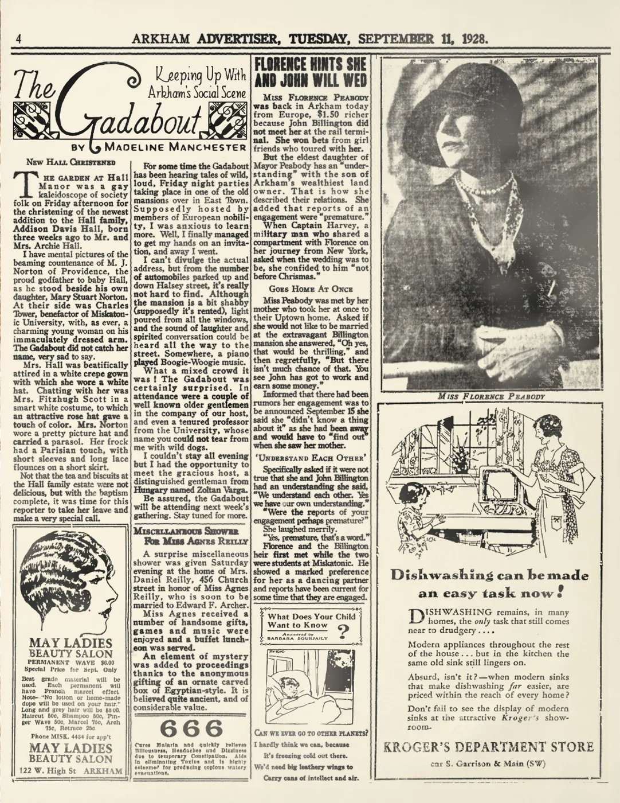

## «Аркхэм Адвертайзер». Полоса 4

**«Аркхэм Адвертайзер», вторник, 11 сентября 1928 года**

### «Гадабаут». Светская жизнь Аркхэма

*Мэделин Манчестер*

**Крестины у Холлов**

В пятницу днём сад Холл-Мэнор пестрел калейдоскопом светского общества: крестили младшего Холла, Аддисона Дэвиса Холла, родившегося три недели назад у мистера и миссис Арчи Холл.

Перед глазами у меня сияющее лицо М. Дж. Нортона из Провиденса, гордого крёстного малыша Холла, рядом с его дочерью Мэри Стюарт Нортон. Подле них — Чарльз Тауэр, благотворитель Мискатоникского университета, как всегда с очаровательной молодой дамой под безупречно одетой рукой. Её имени «Гадабаут», к великому сожалению, не расслышала.

Миссис Холл была блаженно прекрасна в белом крепдешиновом платье и белой шляпке. С ней беседовала миссис Фицхью Скотт в элегантном белом костюме, которому шляпка цвета розы придавала нотку цвета. Миссис Нортон была в прелестной широкополой шляпе и с зонтиком; в её платье чувствовалась парижская нотка — короткие рукава и длинные кружевные оборки на короткой юбке.

Не то чтобы чай с печеньем в поместье Холлов был не хорош, но крещение свершилось, и вашему репортёру пора было откланяться и нанести один совершенно особый визит.

Уже давно «Гадабаут» слышит рассказы о буйных, шумных пятничных вечеринках в одном из старых особняков Ист-Тауна. Говорят, их устраивают члены европейской знати, и мне не терпелось узнать больше. И вот наконец мне удалось раздобыть приглашение — и я отправилась.

Точный адрес раскрыть не могу, но по числу автомобилей вдоль Холси-стрит найти дом совсем нетрудно. Особняк немного обшарпан (говорят, его снимают), но свет лился изо всех окон, а смех и оживлённые разговоры было слышно с улицы. Где-то рояль играл буги-вуги.

Какая пёстрая публика! «Гадабаут» была поистине удивлена. Там были двое хорошо известных пожилых джентльменов в обществе хозяина и даже штатный профессор университета, чьё имя из меня не вытянуть и дикими собаками.

Остаться на весь вечер я не могла, но успела познакомиться с любезным хозяином — видным господином из Венгрии по имени Золтан Варга.

Будьте уверены, «Гадабаут» посетит и встречу на следующей неделе. Следите за новостями.

**Разные подарки для мисс Агнес Рейли**

В субботу вечером миссис Дэниел Рейли устроила у себя дома, на Чёрч-стрит, 456, неожиданный приём в честь мисс Агнес Рейли, которая вскоре выходит замуж за Эдварда Ф. Арчера.

Мисс Агнес получила немало прекрасных подарков. Гости играли, слушали музыку и угощались за буфетным столом.

Нотку таинственности внёс подарок от неизвестного дарителя — искусно вырезанная шкатулка в египетском стиле. Предполагают, что она весьма древняя и стоит немалых денег.

> **Салон красоты «Мэй лэдис».** Перманентная завивка — $6. Особая цена только в сентябре. Работаем с материалами высшего качества. Каждая завивка даёт эффект французской волны Марселя. Никаких лосьонов и домашних снадобий для ваших волос. Длинные и седые волосы — $8. Стрижка, мытьё головы и укладка пальцами — по 50 центов, завивка Марселя и оформление бровей — по 75 центов, поправка укладки — 25 центов. Запись по телефону MISK 4484. Уэст-Хай-стрит, 122, Аркхэм.

> **666.** Лечит малярию и быстро снимает желчные недомогания, головную боль и головокружение от временного запора. Помогает вывести токсины и высоко ценится за способность вызывать обильный жидкий стул.

### Флоренс намекает на свадьбу с Джоном

Мисс Флоренс Пибоди сегодня вернулась из Европы в Аркхэм на полтора доллара богаче, поскольку Джон Биллингтон не встретил её на вокзале. Она выиграла пари у подруг, с которыми путешествовала.

Впрочем, у старшей дочери мэра Пибоди есть «договорённость» с сыном самого богатого землевладельца Аркхэма. Так она сама описывает их отношения. Слухи о помолвке она назвала «преждевременными».

Когда капитан Харви, военный, ехавший с Флоренс в одном купе из Нью-Йорка, спросил, когда свадьба, она доверительно ответила: «Не раньше Рождества».

**С вокзала прямо домой**

На вокзале Флоренс встретила мать и сразу отвезла домой, в Аптаун. На вопрос, не хотелось бы ей сыграть свадьбу в роскошном особняке Биллингтонов, она сказала: «Ах да, это было бы чудесно». И с сожалением добавила: «Только вряд ли получится. Джону, видите ли, придётся работать и зарабатывать».

Когда ей сказали, что, по слухам, о помолвке объявят 15 сентября, она ответила, что «понятия об этом не имеет», поскольку была в отъезде, и ей ещё предстоит «всё выяснить» у матери.

**«Мы понимаем друг друга»**

На прямой вопрос о том, есть ли у неё с Джоном Биллингтоном уговор, она ответила: «Мы понимаем друг друга. Да, у нас своя договорённость».

— Значит, слухи о вашей помолвке пока преждевременны?

Она весело рассмеялась.

— Да, преждевременны. Подходящее слово.

Флоренс и наследник Биллингтонов познакомились, ещё когда оба учились в Мискатоникском университете. На танцах он явно предпочитал её другим партнёршам, и уже некоторое время ходят слухи об их помолвке.

*Подпись к фотографии. Мисс Флоренс Пибоди.*

> **О чём хочет узнать ваш ребёнок?** Отвечает Барбара Бурджейли.
>
> **Сможем ли мы когда-нибудь полететь на другие планеты?**
>
> Вряд ли: там лютый холод. Нам понадобились бы большие кожистые крылья, чтобы нести баллоны с разумом и воздухом.

> **Теперь мыть посуду стало легко!** Во многих домах мытьё посуды остаётся единственной работой, похожей на каторгу. Повсюду в доме современная техника, а на кухне всё та же старая раковина. Нелепо, правда? Ведь современные раковины, с которыми мыть посуду гораздо легче, теперь по карману любой семье. Непременно загляните на выставку современных раковин в уютный демонстрационный зал «Крогера». Универмаг «Крогер», юго-западный угол Саут-Гаррисон-стрит и Мейн-стрит.
