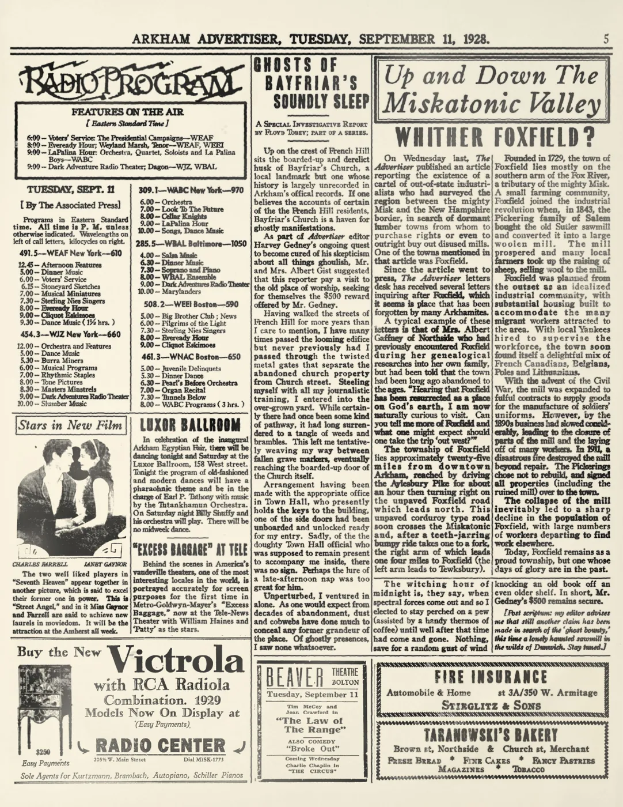

## «Аркхэм Адвертайзер». Полоса 5

**«Аркхэм Адвертайзер», вторник, 11 сентября 1928 года**

### Программа радио

**Главное в эфире** (восточное стандартное время)

- 18:00 — «Служба избирателя». Президентская кампания (WEAF).
- 20:00 — «Час Эвереди». Тенор Уэйланд Марш (WEAF, WEEI).
- 21:00 — «Час Ла-Палины». Оркестр, квартет, солисты и «Парни Ла-Палины» (WABC).
- 21:00 — Радиотеатр «Тёмные приключения». «Дагон» (WJZ, WBAL).

**Вторник, 11 сентября.** По материалам «Ассошиэйтед Пресс». Время восточное стандартное. В оригинале часы указаны после полудня, если не оговорено иное. Слева от позывного указана длина волны в метрах, справа — частота в килогерцах.

| Станция | Передачи |
|---|---|
| 491,5 — WEAF, Нью-Йорк — 610 | 12:45 Дневная программа · 17:00 Музыка к ужину · 18:00 «Служба избирателя» · 18:15 «Зарисовки со Стонъярда» · 19:00 Музыкальные миниатюры · 19:30 Певцы Стерлинга Найса · 20:00 «Час Эвереди» · 21:00 «Эскимосы Клико» · 21:30 Танцевальная музыка (1½ часа) |
| 454,3 — WJZ, Нью-Йорк — 660 | 12:00 Оркестр и другие передачи · 17:00 Танцевальная музыка · 17:30 «Горняки Бурры» · 18:00 Музыкальные передачи · 19:00 «Ритмы Стейплса» · 20:00 «Звуковые картины» · 20:30 «Менестрели Мастерса» · 21:00 Радиотеатр «Тёмные приключения» · 22:00 Музыка перед сном |
| 309,1 — WABC, Нью-Йорк — 970 | 18:00 Оркестр · 19:00 «Взгляд в будущее» · 20:00 «Рыцари подвала» · 21:00 «Час Ла-Палины» · 22:00 Песни и танцевальная музыка |
| 285,5 — WBAL, Балтимор — 1050 | 16:00 Сальса · 18:30 Музыка к ужину · 19:30 Сопрано и фортепиано · 20:00 Ансамбль WBAL · 21:00 Радиотеатр «Тёмные приключения» · 22:00 «Мэрилендцы» |
| 508,2 — WEEI, Бостон — 590 | 17:00 «Клуб старшего брата», новости · 18:00 «Паломники света» · 19:30 Певцы Стерлинга Найса · 20:00 «Час Эвереди» · 21:00 «Эскимосы Клико» |
| 461,3 — WNAC, Бостон — 650 | 17:00 Детская преступность · 17:30 Танцы за ужином · 18:30 Оркестр Пёрла Бифора · 19:00 Органный концерт · 19:30 «Тоннели под землёй» · 20:00 Передачи WABC (3 часа) |

*Прим. перев.:* В радиопрограмме напечатано Delinquets вместо Delinquents.

### Звёзды в новом фильме

*Подписи к фотографии. Чарльз Фаррелл, Джанет Гейнор.*

Двое любимцев публики, сыгравшие в «Седьмом небе», вновь появятся вместе. Говорят, новая картина ещё сильнее прежней. Она называется «Уличный ангел». Мисс Гейнор и Фарреллу прочат новые лавры в мире кино. Фильм идёт в «Амхерсте» всю неделю.

### Танцевальный зал «Луксор»

В честь открытия первой Египетской ярмарки Аркхэма сегодня и в субботу в зале «Луксор» по адресу Уэст-стрит, 158, состоятся танцы. Сегодня Эрл П. Тэтони распорядится программой старинных и современных танцев в духе эпохи фараонов. Играет оркестр «Тутанхамон». В субботу вечером выступит Билли Шаффи со своим оркестром. Танцев среди недели не будет.

### «Лишний багаж» в кинотеатре «Теле»

Закулисье американских театров варьете — одно из самых любопытных мест на свете. В фильме «Лишний багаж» студии «Метро-Голдвин-Майер» его впервые достоверно показали на экране. Фильм идёт в кинотеатре «Теле-ньюс», в главных ролях Уильям Хейнс и «Патти».

### Призраки церкви Бейфрайарс спят крепко

*Специальное расследование Флойда Тоби. Из серии статей.*

На вершине Френч-Хилла стоит заколоченная и заброшенная церковь Бейфрайарс. Всем известна эта местная достопримечательность, хотя в официальных записях Аркхэма почти ничего не говорится о её истории. Если верить некоторым жителям Френч-Хилла, в церкви то и дело видят призраков.

Редактор «Адвертайзера» Харви Гедни всё ещё ищет того, кто излечит его от скептицизма в вопросах потустороннего. Мистер и миссис Альберт Гист предложили мне посетить старую церковь, надеясь тем самым получить обещанные мистером Гедни $500.

Я хожу по улицам Френч-Хилла уже столько лет, что и говорить неловко, и не раз проходил мимо громады церкви. Однако через перекошенные железные ворота, отделяющие заброшенный погост от Чёрч-стрит, раньше не ступал. Призвав на помощь всю репортёрскую выдержку, я вошёл в заросший двор. Когда-то здесь, видимо, была дорожка, но давно скрылась под бурьяном и колючками. Я осторожно пробрался между поваленными надгробиями к заколоченной двери церкви.

Мы заранее условились с нужным отделом мэрии, у которого сейчас ключи от здания. С одной боковой двери сняли доски, а саму дверь отперли. К сожалению, отважного чиновника, которому полагалось дождаться меня и войти вместе со мной, нигде не было видно. Может, не устоял перед соблазном вздремнуть под вечер.

Без лишних раздумий я вошёл один. Как и следовало ожидать после десятилетий запустения, пыль и паутина изрядно скрыли былое великолепие церкви. Призраков я не обнаружил.

Говорят, привидения выходят в колдовской час, в полночь. Я решил просидеть на скамье до глубокой ночи, благо прихватил термос с кофе. Ничего не случилось, если не считать случайного порыва ветра, смахнувшего старую книгу с ещё более старой полки. Словом, $500 мистера Гедни пока в целости.

> **P. S.** Редактор сообщает, что на «призрачную награду» есть ещё один претендент. На этот раз речь об одинокой лесопилке с привидениями в глуши Данвича. Следите за новостями.

*Прим. перев.:* В заметке о церкви встречаются offical и повтор the the.

### Вдоль и поперёк долины Мискатоника

**Куда делся Фоксфилд?**

В прошлую среду «Адвертайзер» сообщил о картеле промышленников из других штатов, обследовавших край между могучим Мискатоником и границей Нью-Гэмпшира. Они ищут пришедшие в упадок лесопромышленные городки, чтобы купить у них права на простаивающие предприятия или выкупить предприятия целиком. Одним из упомянутых городков был Фоксфилд.

С тех пор редакция получила несколько писем с расспросами о Фоксфилде. Похоже, многие аркхэмцы о нём забыли.

Характерное письмо прислала миссис Альберт Гаффни из Нортсайда. Она прежде встречала название Фоксфилда, когда изучала родословную семьи, и слышала, что городок уже давно заброшен. «Узнав, что Фоксфилд, оказывается, ещё существует на Божьем свете, я, конечно, захотела там побывать. Не расскажете ли о Фоксфилде и о том, чего ждать от поездки “на запад”?»

Тауншип Фоксфилд лежит примерно в 40 км от центра Аркхэма. Надо ехать по Эйлсберийской дороге около часа, затем повернуть направо, на грунтовую Фоксфилд-роуд, ведущую на север. Эта гать из брёвен вскоре пересекает Мискатоник. Дальше дорога трясёт так, что стучат зубы, пока не доберёшься до развилки. Правая ветвь ведёт в Фоксфилд, до которого около 6,4 км. Левая — в Тьюксбери.

Фоксфилд, основанный в 1729 году, расположен по большей части на южном рукаве реки Фокс, притоке могучего Мискатоника. Изначально это была небольшая земледельческая община. Промышленный переворот пришёл сюда в 1843 году, когда Пикеринги из Сейлема купили старую лесопилку Сатлера и переоборудовали её в большую шерстяную фабрику. Фабрика процветала, и многие здешние фермеры начали разводить овец, продавая ей шерсть.

Фоксфилд с самого начала задумывали как образцовый фабричный посёлок и выстроили основательные жилые дома для приезжих рабочих. Надсмотрщиков набирали из местных янки, и вскоре в городке сложилось приятное соседство франкоканадцев, бельгийцев, поляков и литовцев.

С началом Гражданской войны фабрику расширили, чтобы выполнить заказы на материалы для солдатского обмундирования. К 1890-м годам дела пошли заметно хуже. Часть фабрики закрыли, многие рабочие лишились мест. В 1911 году опустошительный пожар уничтожил фабрику. Пикеринги решили её не восстанавливать и передали городу всю свою недвижимость, включая развалины.

С гибелью фабрики население Фоксфилда резко сократилось. Рабочие во множестве уезжали в поисках заработка.

Фоксфилд и сейчас полон достоинства, хотя славные дни городка остались в прошлом.

*Прим. перев.:* В заметке о Фоксфилде напечатано fulful вместо fulfil.

> **Новая «Виктрола» в комплекте с RCA «Радиола».** Модели 1929 года уже в выставочном зале Радиоцентра. $250, удобная рассрочка. Уэст-Мейн-стрит, 205½. Телефон MISK-1773. Эксклюзивный представитель фортепиано «Курцман», «Брамбах», «Аутопиано» и «Шиллер».

> **Кинотеатр «Бивер», Болтон.** Вторник, 11 сентября. Тим Маккой и Джоан Кроуфорд в фильме «Закон пастбища». Также комедия «Вырвался на волю». В среду — Чарли Чаплин в фильме «Цирк».

> **Страхование от пожара.** Автомобили и жильё. «Штиглайц и сыновья». Уэст-Армитидж-стрит, 350, офис 3A.

> **Пекарня Тарановского.** Браун-стрит в Нортсайде и Чёрч-стрит в Торговом районе. Свежий хлеб, изысканные торты, сдобная выпечка. Журналы, табак.

*Прим. перев.:* В рекламе напечатано Stieglitz & Sons. Имя владельца приведено в форме, принятой в базе (см. с. 195).
