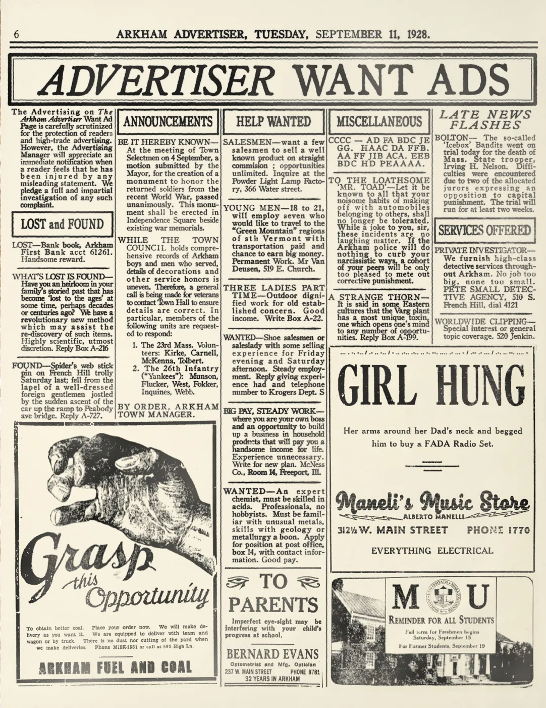

## «Аркхэм Адвертайзер». Полоса 6

**«Аркхэм Адвертайзер», вторник, 11 сентября 1928 года**

### Объявления «Адвертайзера»

В интересах читателей и добросовестных рекламодателей редакция тщательно проверяет объявления, поступающие на эту полосу. Если вы пострадали от недостоверного объявления, заведующий отделом рекламы просит сообщить об этом сразу же. Обещаем полностью и беспристрастно расследовать каждую такую жалобу.

**Бюро находок**

- **Потеряна** банковская книжка Первого банка Аркхэма, счёт № 61261. Щедрое вознаграждение.
- **Вернём потерянное.** Случалось ли в истории вашей семьи, что фамильная реликвия «затерялась в веках» — несколько десятилетий, а то и столетий назад? Наш новый, совершенно научный метод может помочь её найти. Строжайшая конфиденциальность. Ответы в ящик A-216.
- **Найдена** галстучная булавка в виде паутины. В прошлую субботу в трамвае на Френч-Хилл она упала с лацкана хорошо одетого иностранца, когда вагон резко рванул вверх по подъёму к мосту на Пибоди-авеню. Ответы в ящик A-727.

**Извещения**

Доводим до всеобщего сведения, что на заседании городского совета 4 сентября единогласно одобрено предложение мэра возвести памятник солдатам, вернувшимся с недавней Мировой войны. Памятник установят на площади Независимости рядом с существующими военными мемориалами.

Городской совет располагает подробными списками аркхэмцев, служивших в армии. Однако сведения о наградах и других знаках отличия неполны. Совету нужен отклик ветеранов. Просим обратиться в мэрию и сверить сведения. В особенности это касается перечисленных ниже военнослужащих.

1. 23-й Массачусетский добровольческий полк — Кирк, Карнелл, Маккенна, Толберт.
2. 26-я пехотная дивизия («Янки») — Мансон, Флакер, Уэст, Фоккер, Инквайнс, Уэбб.

*По распоряжению управляющего городом Аркхэмом.*

**Требуются работники**

- **Продавцы.** Нужны несколько человек для продажи известного товара за комиссионные. Возможности не ограничены. Справляться на ламповой фабрике «Паудер Лайт», Уотер-стрит, 366.
- **Юноши 18–21 года.** Возьмём семерых, желающих отправиться в район Зелёных гор на юге Вермонта. Дорогу оплатим. Хороший заработок, постоянная работа. Мистер Ван Дьюзен, Ист-Чёрч-стрит, 519.
- **Три женщины на неполный день.** Приличная работа на свежем воздухе в давно существующей фирме. Хороший доход. Пишите в ящик A-22.
- **Требуются продавцы обуви, мужчины или женщины,** с опытом торговли. Работать по пятницам вечером и по субботам после полудня. Место постоянное. Сообщите об опыте работы и укажите номер телефона. Универмаг «Крогер», отдел S.
- **Хорошая плата, постоянная работа.** Вы сами себе хозяин. Откройте дело по продаже товаров для дома, которое обеспечит вам хороший доход на всю жизнь. Опыт не требуется. Напишите, чтобы узнать условия. «Макнесс», комната 14, Фрипорт, штат Иллинойс.
- **Требуется опытный химик,** умеющий работать с кислотами. Приглашаем только профессионалов. Необходимо знание редких металлов. Опыт в геологии или металлургии приветствуется. Присылайте заявку с контактными данными в почтовое отделение, ящик 14. Хорошая плата.

**Разное**

- CCCC — AD FA BDC JE GG. HAAC DA FFB. AA FF JIB ACA. EEB BDC HD PEAAAA.
- **Мерзкому «мистеру Тоуду».** Да будет всем известно, что вашу скверную привычку укатывать на чужих автомобилях больше терпеть не намерены. Для вас, сударь, это шутка, а для прочих — дело серьёзное. Если аркхэмская полиция не найдёт управы на ваше самолюбование, кое-кто из равных вам с удовольствием преподаст вам урок.
- **Странный шип.** В некоторых восточных культурах говорят, что растение варг содержит особый яд, который открывает сознанию множество возможностей. Ответы в ящик A-199.

**Последние известия**

БОЛТОН. Сегодня начался суд над так называемой бандой «Ледника» по делу о гибели сотрудника полиции Массачусетса Ирвинга Х. Нельсона. Возникло затруднение: двое из отобранных присяжных высказались против смертной казни. Процесс продлится не менее двух недель.

**Предлагаем услуги**

- **Частный сыск.** Квалифицированные детективы по всему Аркхэму. Берёмся и за большие, и за малые дела. Детективное агентство Пита Смолла, Саут-Френч-Хилл-стрит, 510. Телефон 4121.
- **Вырезки из мировой прессы.** По специальным и общим темам. Дженкин-стрит, 520.

> *Строка азбукой Морзе над объявлением:* `... . -. -.. / .- .. -.. / - .. .-.. .-.. .. -. --. .... .- ... - / .-- .- ... / .-. .. --. .... -`
>
> «Пришлите помощь. Тиллингаст был прав».
>
> **Девочка повисла** у папы на шее и упросила купить ей радиоприёмник FADA. Музыкальный магазин Манелли, Альберто Манелли. Уэст-Мейн-стрит, 312½. Телефон 1770. Всё из мира электротехники.

> **Воспользуйтесь случаем купить уголь получше.** Заказывайте сейчас. Доставим, когда вам удобно, на телеге или грузовике. При доставке мы не пылим и не портим ваш двор. Телефон MISK-1551. Наш адрес — Хай-лейн, 582. Аркхэмская топливно-угольная компания.

> **Родителям.** Плохое зрение может мешать вашему ребёнку учиться. Бернард Эванс, оптометрист, изготовление очков. Уэст-Мейн-стрит, 237. Телефон 8781. В Аркхэме уже 32 года.

> **Мискатоникский университет. Напоминание всем студентам.** Осенний семестр для первокурсников начинается в субботу, 15 сентября. Для продолжающих обучение — 19 сентября.
