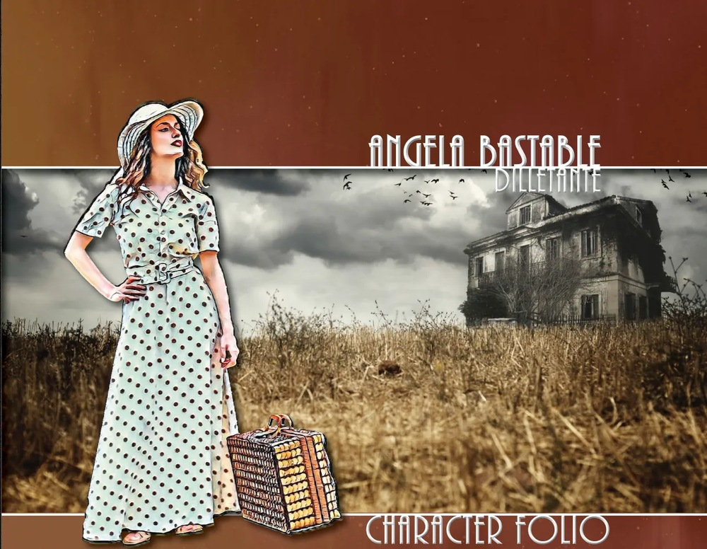

# Готовые сыщики

## Анджела Мэй Бэйстебл

**Дилетантка**

### Лист персонажа

Анджела Бэйстебл родилась в семье зажиточных фермеров в Блэндфорд-Форуме, рыночном городке в Дорсете. Сколько она себя помнила, родители мечтали видеть в ней примерную девочку. Сама она знала, что этого не будет. Других детей в семье не было. Анджела то и дело нарушала родительский запрет водиться с детьми батраков, и её регулярно тащили домой, с головы до пят вымазанную грязью. Анджела росла настоящим сорванцом и гордилась тем, что бегает быстрее, лазает выше и дерётся лучше товарищей, хотя почти все они были крупнее и крепче её. Родители часто приходили в отчаяние, а отец, едва услышав об очередной выходке дочери, привычно называл её «оборвышем».

С годами Анджела не остепенилась. При каждом удобном случае она курила глиняную трубку, часто напивалась с батраками и дралась с любым мужчиной, чья физиономия ей не нравилась. Таких было большинство. Казалось, она вот-вот навлечёт на семью несмываемый позор и даже не подумает раскаяться. И тут случилось немыслимое: Анджела влюбилась.

Её избранник был сыном видного городского юриста и наследником внушительного состояния. Какой уравновешенный, образованный и учтивый молодой человек! Казалось бы, что могло свести два столь разных характера? И всё же с ним Анджела становилась спокойнее, а она пробудила в нём страсть, о которой никто прежде и не догадывался. Вместе им больше ничего не было нужно. В идеальном мире они прожили бы счастливо до конца своих дней. В этом мире вышло иначе.

Его призвали на войну. Во Франции он утонул в грязи, в окопе. Обезумев от горя, Анджела уехала из Англии, решив больше не возвращаться туда, где всё напоминало бы об утрате. Когда через несколько лет скончались родители, она распродала унаследованное имущество и продолжила колесить по свету в надежде убежать от боли. Пока это ей не удалось.

Анджела вспыльчива и любит шокировать окружающих выходками. Она пьёт, курит и спит с кем захочет, хотя по-настоящему её уже ничто не трогает. Она ищет то, что заставит её почувствовать себя живой, пусть даже это её убьёт. Иногда она надеется, что так и случится.
