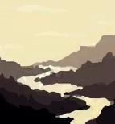

### Предыстория

- Я родилась 19 ноября 189… года в Блэндфорд-Форуме, Дорсет, Англия. Мои родители Джоан и Ричард владели поместьем и фермой в Дорсете.
- До восемнадцати лет я была сорванцом и позором семьи, потом стала провинциальной дебютанткой. Началась Великая война, и я потеряла любимого Артура: он утонул в грязи фландрского окопа.
- Нрав у меня шумный, азартный, буйный, зато я верна своим. Люблю курить глиняную трубку. Терпеть не могу привилегий богатых.
- Хочу жить и любить как мне вздумается. Найти того, с кем я почувствую себя по-настоящему живой, или умереть в попытке. Иногда надеюсь, что ещё встречу моего Артура.
- Моё прозвище — «Оборвыш». Когда-то была англиканкой.
- Лучший миг — когда я расквасила нос Билли Дануэллу за то, что он обижал сестру.
- Худший миг — когда узнала, что Артур утонул в грязи. Тогда кончилась всякая надежда на нормальную жизнь.
- Я хорошенькая, когда мне есть до этого дело, но нрав у меня жёсткий, и всякой чепухи я не терплю. Однажды мне сказали, что в брюках я настоящий красавец. Вид у меня вызывающий, да я и сама такая. Ну и что? Сразу видно, что я за себя постою. Я высокая.
- Я атеистка. «Если Бог есть, он жесток и равнодушен».
- Дороже всего мне глиняная трубка и обручальное кольцо, которое подарил Артур.
- Упрямая, трудолюбивая, независимая. Гедонистка.
- Из травм — лёгкие шрамы с детства, когда я слишком часто карабкалась на деревья и падала. И разбитое сердце.
- Фобий нет.
- Тайные книги, заклинания и артефакты — _____.

### Снаряжение, наличные и имущество

| Допустимые траты | Наличные | Имущество |
|---|---|---|
| $50 | $300 | $30 000 |

Сигареты, табак, трубка, обручальное кольцо, зажигалка, фляжка.

### Шрамы

- Травмы — _____.
- Фобии — _____.
- Тайные книги, заклинания и артефакты — _____.
- Встреченные существа — _____.
