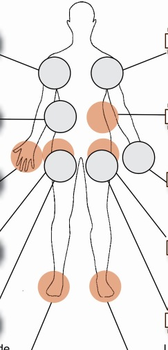

### Оружие и снаряжение при себе

| Где лежит | Что лежит |
|---|---|
| Верхняя одежда, верхний правый карман | — |
| Верхняя одежда, верхний левый карман | — |
| Верхняя одежда, нижний правый карман | — |
| Верхняя одежда, нижний левый карман | Табак, трубка |
| Правая рука | Обручальное кольцо |
| Левая рука | — |
| Юбка или брюки, передний правый карман | Зажигалка |
| Юбка или брюки, передний левый карман | Сигареты |
| Юбка или брюки, задний правый карман | — |
| Юбка или брюки, задний левый карман | — |
| Правый сапог | Фляжка |
| Левый сапог | Припрятанные деньги |
| Рюкзак | — |
| Другие карманы | — |
| Сумочка или портфель | Деньги, ключи от дома, старомодная косметика, пудреница |
| Вещмешок или большой мешок | — |
| Дома | Нарядная одежда, рабочая одежда, шляпы. Снаряжение для скалолазания и ледоруб. Большая коллекция крепких напитков. «К чёрту сухой закон!» |
