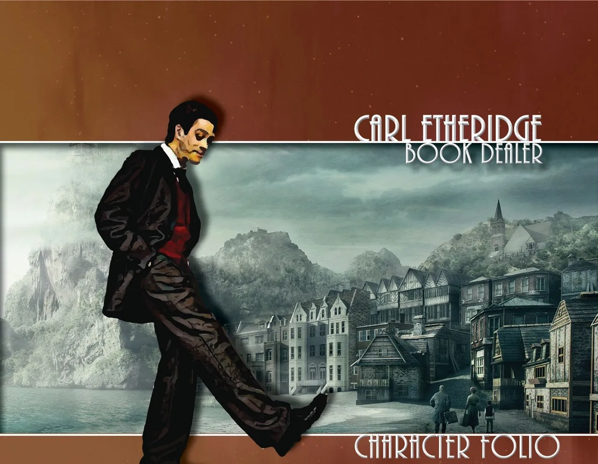

## Карл Этеридж

**Книготорговец**

### Лист персонажа

В детстве Карл Этеридж знал наверняка одно: он терпеть не может Канзас-Сити и отчаянно хочет оттуда уехать. Грипп, перенесённый в детстве, сильно подорвал его здоровье. Карл сделался тихим и замкнутым. Мать умерла, когда ему не исполнилось и трёх, а отец считал сына безнадёжным мечтателем. Большую часть детства Карл провёл за книгами и решил, что, когда вырастет, станет писателем или библиотекарем. Подходящих мест почти не было, и он довольствовался работой учителя. Он продолжал мечтать о далёких краях, о которых читал мальчишкой. Когда на него обратила внимание красавица с Восточного побережья, Карл не упустил случая.

Петра Коул была дочерью Артура Коула, инженера-строителя, который занимался перестройкой городских коммуникаций Канзас-Сити. Ей очень полюбился тихий, начитанный Карл. После недолгих ухаживаний они поженились и отправились в Бостон знакомиться с её семьёй. Коулы, бостонские аристократы старой закалки, встретили нового зятя без восторга и в знак неодобрения оставили Петру без гроша. Чтобы содержать молодую жену и прокормить детей, которых они надеялись завести, Карл взваливал на себя всё больше работы и месяцами не бывал в Бостоне. Петра любила Карла, но разлука её не особенно тяготила. Она могла вволю наслаждаться родным городом и помогать отцу в семейном деле.

И эта жизнь оборвалась, когда Петра и её отец погибли при обрушении здания, которое он осматривал в Филадельфии. Карл остался один в городе, где единственная семья, которую он мог считать своей, от него отвернулась. К счастью, жизнь Петры была хорошо застрахована. Полученных денег хватило, чтобы уехать из Бостона и купить маленькую книжную лавку в приморском Кингспорте. Здесь Карл торгует книгами о море и разыскивает редкости для бостонских коллекционеров и аукционных домов. Через его руки проходили поистине странные книги. Времени почитать и помечтать о дальних берегах у него по-прежнему вдоволь.
