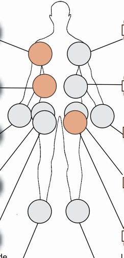

### Оружие и снаряжение при себе

| Где лежит | Что лежит |
|---|---|
| Верхняя одежда, верхний правый карман | Первое издание «С Земли на Луну» Жюля Верна |
| Верхняя одежда, верхний левый карман | — |
| Верхняя одежда, нижний правый карман | Дерринджер .25, шесть патронов россыпью, хорошая ручка |
| Верхняя одежда, нижний левый карман | — |
| Правая рука | — |
| Левая рука | — |
| Юбка или брюки, передний правый карман | — |
| Юбка или брюки, передний левый карман | Ключи, деньги, бумажник |
| Юбка или брюки, задний правый карман | — |
| Юбка или брюки, задний левый карман | — |
| Правый сапог | — |
| Левый сапог | — |
| Рюкзак | — |
| Другие карманы | — |
| Вещмешок | Лупа, экземпляр «Железнодорожного путеводителя Эплтона», сменная одежда на любой случай |
| Автомобиль | Большой вещмешок, лупа, «Железнодорожный путеводитель Эплтона» (Новая Англия, 1920) |
| Дома | Добротный гардероб по моему достатку, на разные случаи жизни. Четырёхместный «Линкольн L». 23 патрона россыпью к дерринджеру .25. |
