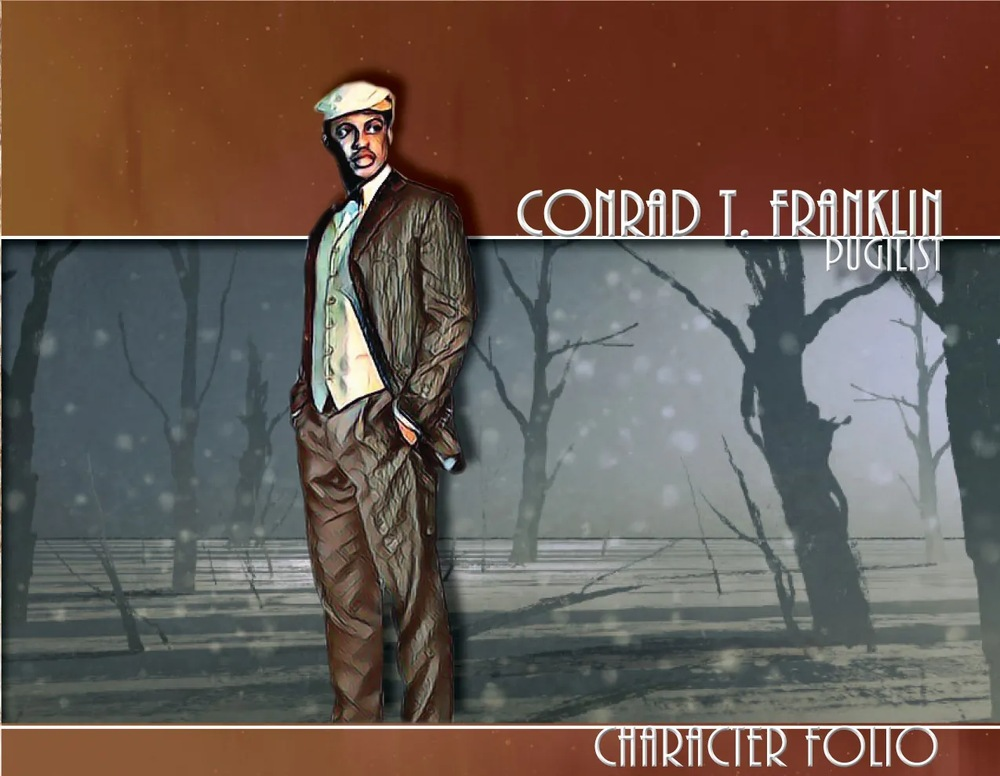

## Конрад Т. Франклин

**Кулачный боец и боксёр**

### Лист персонажа

С тех пор как Конрад Франклин перебрался на северо-восток, чуть перешагнув двадцатилетие, он почти сделал себе карьеру на том, что его недооценивали. Стоило узнать его ближе, и становилось ясно, сколько всего скрывается за красивым лицом и жилистой фигурой.

Конрад родился в Чикаго. Его отец был врачом в местной общине, и от сына ждали, что он пойдёт по его стопам. Но Конрада больше тянуло к технике, и вскоре стало ясно, что из него выйдет инженер. «Генри Форд увидел будущее, пап!»

Когда началась Великая война, Конрад учился в техническом училище. Франция оказалась зажата между великими державами, стала Западным фронтом и была опустошена тяжёлыми боями. После войны Конраду было нелегко вернуться к привычной жизни с семьёй. Не находя себе места, он покинул Город ветров и раздобыл жильё в Бостоне. Жилось там трудно. Обыватель считал чернокожего либо глупцом, либо преступником, и устроиться на работу было нелегко. В англо-ирландском Бостоне темнокожие постоянно сталкивались с дискриминацией. Конрад никак не мог применить свою подготовку механика и совсем приуныл. Однажды у подпольного бара он увидел, как четверо громил напали на прохожего. Тут ему пригодились и сила, и ловкость: в считаные минуты все четверо без сознания лежали на мостовой. Один из зевак смекнул, что перед ним удачная находка, и представился Конраду как местный устроитель боёв. Он взял молодого человека под крыло и начал представлять его как нового претендента под прозвищем «Цветной красавчик».

К изумлению самого Конрада, на ринге у него всё пошло отлично. С несколькими тренерами он научился обращать в свою пользу быстроту реакции и размах рук. У него появились поклонники и среди бостонских любителей бокса, и среди зрителей всех цветов кожи и вероисповеданий. Успехи Конрада заметил печально известный гангстер «Блэки» Бручетти и предложил немалые деньги за проигрыш в важном поединке. Конрад увидел в этом возможность уйти из бокса и взял деньги. Но въедливый журналист из «Boston Globe» раскрыл сговор, и Конрад лишился лицензии. Нужда заставила его выступать в подпольных боях на голых кулаках. Пока что ни он, ни его соперники серьёзно не пострадали. Конрад понимает, что рано или поздно кого-нибудь покалечат, если не убьют.
