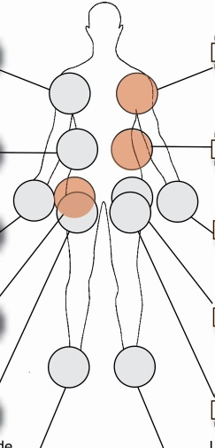

### Оружие и снаряжение при себе

| Где лежит | Что лежит |
|---|---|
| Верхняя одежда, верхний правый карман | — |
| Верхняя одежда, верхний левый карман | Потёртый зажим для денег с $7 |
| Верхняя одежда, нижний правый карман | — |
| Верхняя одежда, нижний левый карман | «Зелёная книга для афроамериканских путешественников» |
| Правая рука | — |
| Левая рука | — |
| Юбка или брюки, передний правый карман | $2 купюрами и мелочью, ключ от жилья |
| Юбка или брюки, передний левый карман | — |
| Юбка или брюки, задний правый карман | — |
| Юбка или брюки, задний левый карман | — |
| Правый сапог | — |
| Левый сапог | — |
| Рюкзак | — |
| Другие карманы | — |
| Сумочка или портфель | — |
| Вещмешок или большой мешок | Боксёрские перчатки, полотенце, боксёрские трусы и кожаные туфли, одно руководство по обслуживанию автомобиля |
| Дома | Нарядная рубашка, носки, хорошие брюки, повседневная одежда, подтяжки. Два руководства по обслуживанию автомобилей. |
