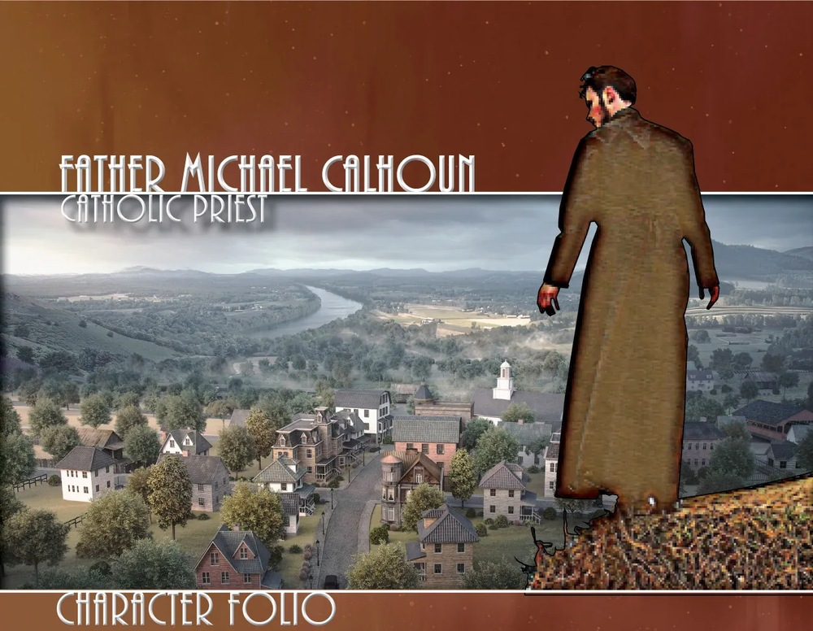

## Отец Майкл Калхун

**Католический священник**

### Лист персонажа

Тридцатитрёхлетний отец Майкл — самый молодой священник Болтона, промышленного городка неподалёку от Аркхэма. Церковное начальство ценит его, прихожане его уважают.

Майкл родился в Аркхэме и вырос на жутких преданиях о городе ведьм. Он с детства верил в скрытые силы, стоящие за видимым миром. Младшего из трёх братьев завораживала торжественная красота римского обряда. Вскоре он почувствовал призвание служить Богу. Семья с неохотой смирилась с его решением, и сразу после колледжа Майкл поступил в семинарию.

За годы учёбы его вера лишь окрепла. Из семинарии он вышел с твёрдым намерением как можно лучше проповедовать слово Божье. После пяти лет в Бостоне Церковь направила Майкла в Болтон, где его паству составляют бедные рабочие фабрики, в основном ирландцы, поляки и итальянцы. Ни одна из этих общин, похоже, не жалует другие.

В последние годы Майкл вновь начал ощущать скрытые силы мира. Теперь они преследуют его в жутких снах. Он гадает, что неладно с Болтоном и соседними городами. А вдруг, что гораздо хуже, что-то неладно с ним самим? Недавно его вера подверглась испытанию. Он выяснил, что священник, которого он сменил, покончил с собой. Прежде Майклу говорили, что тот умер после недолгой болезни. Причины самоубийства остаются неясны. Эта мысль не даёт Майклу покоя: церковное начальство солгало ему, и, что ещё страшнее, его брат во Христе, должно быть, обрёк себя на погибель.

Отец Майкл умён, хорошо образован и интересуется и природой, и сверхъестественным. Он много читал об истории оккультизма и отлично разбирается в людях. За эти годы у него собралась небольшая библиотека трудов о сверхъестественном. Узнай о ней отцы церкви, они, пожалуй, встревожились бы. В колледже Майкл немного играл в американский футбол, а теперь старается поддерживать форму тренировками и спортом.
