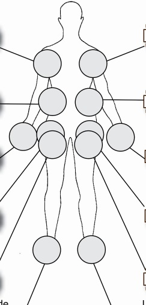

### Оружие и снаряжение при себе

| Где лежит | Что лежит |
|---|---|
| Верхняя одежда, верхний правый карман | — |
| Верхняя одежда, верхний левый карман | Бумажник, фляжка с лаймовым кордиалом |
| Верхняя одежда, нижний правый карман | — |
| Верхняя одежда, нижний левый карман | — |
| Правая рука | — |
| Левая рука | — |
| Юбка или брюки, передний правый карман | — |
| Юбка или брюки, передний левый карман | — |
| Юбка или брюки, задний правый карман | — |
| Юбка или брюки, задний левый карман | — |
| Правый сапог | — |
| Левый сапог | — |
| Рюкзак | — |
| Другие карманы | Распятие на шее |
| Сумочка или портфель | — |
| Вещмешок или большой мешок | — |
| Дома | В церкви — облачение, брюки, рубашки, священнический воротничок, Библия. Дома — брюки, рубашки, священнический воротничок, Библия, хорошие туфли, тяжёлое пальто. В доме престарелых священников Святого Колумбы, куда я часто наведываюсь, — небольшая библиотека оккультных книг в потайной комнате. |
