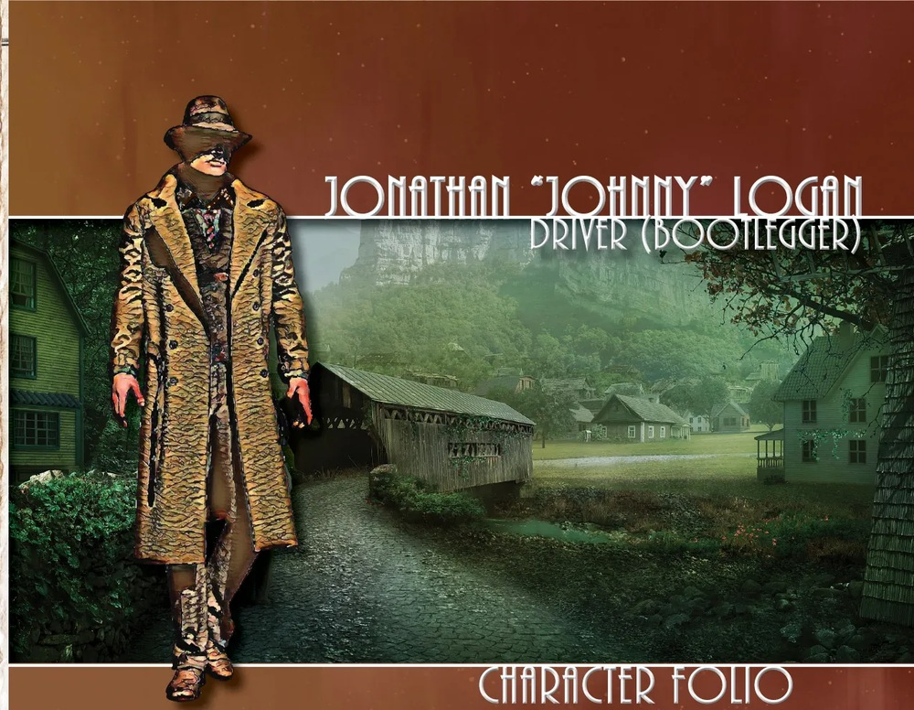

## Джонатан «Джонни» Логан

**Водитель и бутлегер**

### Лист персонажа

Если Джонни Логан и любит что-то больше лихих женщин, то разве что лихие машины. Автомобили завораживали его с малых лет. Вместо уроков он пропадал в местной автомастерской, по локоть в потрохах какой-нибудь развалюхи. Учился чинить, настраивать и выжимать из машин лишнюю скорость. Парень схватывал на лету, механики взяли его под крыло как талисман мастерской, хотя, по правде, и сами у него кое-чему научились. Едва Джонни дорос до того, чтобы видеть дорогу поверх капота, он впервые сел за руль. Дальше всё было решено. Как только возраст позволил, он бросил школу и устроился на полный день в мастерскую, где доводил машины местных бандитов. Он приловчился делать машины такими, чтобы отрываться от полиции, и вскоре накопил на первый взнос за собственную. На купленную колымагу прочие смотрели как на металлолом. Джонни загнал её в угол гаража и разобрал до рамы. За несколько месяцев он любовно собрал её заново, деталь за деталью, пока она не засияла почти как новая. Старшие механики подшучивали над ним и его «малышкой», пока Джонни впервые не завёл её и не выкатил из гаража под басовитый рёв мотора. С тех пор подшучивали куда меньше, даже когда он так и назвал машину — «Бэйби».

Вполне естественно, что талант механика у Джонни сочетался с талантом водителя. Казалось, каждый час, свободный от ремонта машин, он проводил за рулём «Бэйби». Поговаривали, что он прямо там и родился.

Содержать автомобиль недёшево. К заработку в мастерской прибавились подработки на бостонское преступное дно. Джонни прослыл надёжным и исполнительным курьером, который доставит свёрток из одного места в другое и не попадётся легавым. Он знал бостонские задворки как свои пять пальцев, а мотор «Бэйби» позволял уйти почти от любой погони. Джонни окончательно покинул Бостон после того, как под видом простой доставки его наняли водителем на ограбление банка, пошедшее наперекосяк. В «Бэйби» попало несколько пуль. Джонни этого было довольно. Он распрощался с Бобовым городом и перебрался в глубинку.

Теперь днём Джонни работает одним из немногих аркхэмских таксистов, а по ночам возит грузы для местных бутлегеров. За минувшие годы он закалился и возит пистолет в бардачке, а обрез — под приборной панелью. Он по-прежнему обожает возиться с машинами и по выходным помогает в автомастерской у шоссе от Динс-Корнерс. Он приветлив, но близких друзей у него мало. Место в его сердце занято «Бэйби», первой и единственной любовью.
