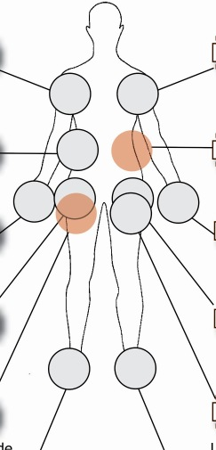

### Оружие и снаряжение при себе

| Где лежит | Что лежит |
|---|---|
| Верхняя одежда, верхний правый карман | — |
| Верхняя одежда, верхний левый карман | — |
| Верхняя одежда, нижний правый карман | — |
| Верхняя одежда, нижний левый карман | Пистолет и 18 патронов |
| Правая рука | — |
| Левая рука | — |
| Юбка или брюки, передний правый карман | — |
| Юбка или брюки, передний левый карман | — |
| Юбка или брюки, задний правый карман | Ключи от дома, деньги |
| Юбка или брюки, задний левый карман | — |
| Правый сапог | — |
| Левый сапог | — |
| Рюкзак | — |
| Другие карманы | — |
| Сумочка или портфель | — |
| Вещмешок или большой мешок | Чёрная одежда для скрытных дел (балаклава, чёрные брюки, перчатки, чёрный свитер), дробовик и 24 патрона к нему, 32 патрона к револьверу |
| Дома | Шляпа, хороший костюм, повседневная одежда. В «Бэйби» — 24 патрона к дробовику, руководство по устройству машины, коробка шипов против шин (на два применения), ящик с автомобильными инструментами. |
