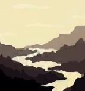

### Предыстория

- Я родилась 14 июля 189… года в Квинсе, Нью-Йорк. Мои родители Сара и Эфраим жили в Квинсе. Мать вела дом, отец торговал кошерными продуктами.
- До четырнадцати лет я училась, потом смогла помогать по дому. В Великую войну я видела, как слишком много славных людей ушло на фронт и не вернулось.
- Я уверенная, общительная, живу на износ. Люблю виски и сигары. Не выношу коррупции и фанатиков.
- Хочу дорасти до главного репортёра «Аркхэм Адвертайзер».
- Меня зовут «Кровавая Рода». Религии нет, я убеждённая атеистка.
- Лучший миг — когда я раскрыла, что бывший член городского совета Нью-Йорка крутил романы за казённый счёт, и смотрела, как жена выставляет его вещи за дверь.
- Худший миг — когда я смотрела, как горит мой дом и гибнут трое соседей. Я знала, что они погибли из-за меня.
- Я смелая, жёсткая, одеваюсь небрежно. Волосы взъерошены, яркая помада, берет. Иногда выгляжу слегка навеселе. Порой я нарочно так делаю, чтобы казаться безобидной.
- Я атеистка и с удовольствием объясню окружающим, в чём они ошибаются. Родных оставлю в покое.
- Самая дорогая вещь — мой фотоаппарат. Я его, э-э, одолжила у бывшего.
- Люблю удовольствия и хорошо готовлю. Травм и фобий нет.
- Тайные книги, заклинания и артефакты — _____.

### Снаряжение, наличные и имущество

| Допустимые траты | Наличные | Имущество |
|---|---|---|
| $10 | $30 | $750 |

Фотоаппарат, плёнка, лампы-вспышки, косметика, револьвер .38 и 20 патронов, яркая одежда для вечеринок, маленькая аркхэмская квартира рядом с университетом, походная одежда, фонарик.

### Шрамы

- Травмы — _____.
- Фобии — _____.
- Тайные книги, заклинания и артефакты — _____.
- Встреченные существа — _____.
