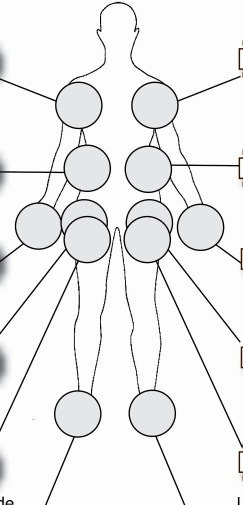

### Оружие и снаряжение при себе

| Где лежит | Что лежит |
|---|---|
| Верхняя одежда, верхний правый карман | — |
| Верхняя одежда, верхний левый карман | — |
| Верхняя одежда, нижний правый карман | — |
| Верхняя одежда, нижний левый карман | — |
| Правая рука | — |
| Левая рука | — |
| Юбка или брюки, передний правый карман | — |
| Юбка или брюки, передний левый карман | — |
| Юбка или брюки, задний правый карман | — |
| Юбка или брюки, задний левый карман | — |
| Правый сапог | — |
| Левый сапог | — |
| Рюкзак | — |
| Другие карманы | Фотоаппарат на шее |
| Сумочка или портфель | Плёнка, лампы-вспышки, помада и пудреница с зеркальцем, револьвер .38 и 20 патронов, ключи, деньги, блокнот и ручка |
| Вещмешок или большой мешок | Походная одежда, фонарик |
| Дома | Яркая одежда для вечеринок в маленькой квартире в Аркхэме, рядом с университетом. Походная одежда и фонарик. |
